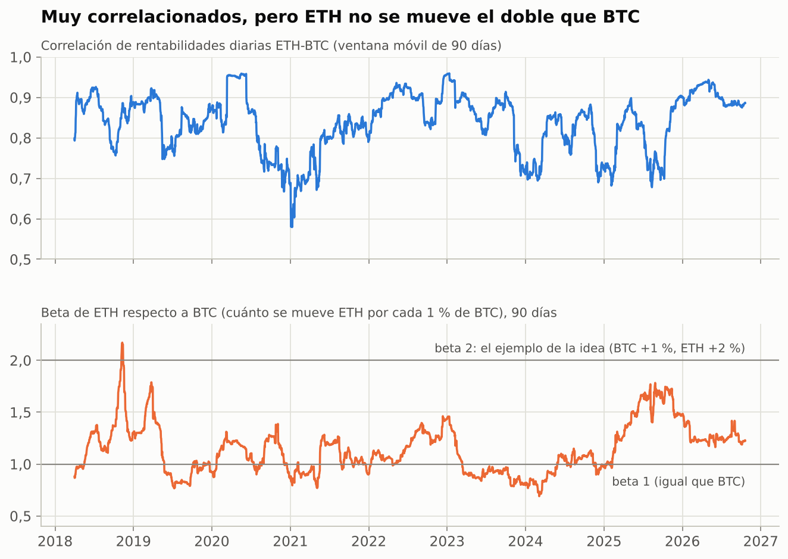
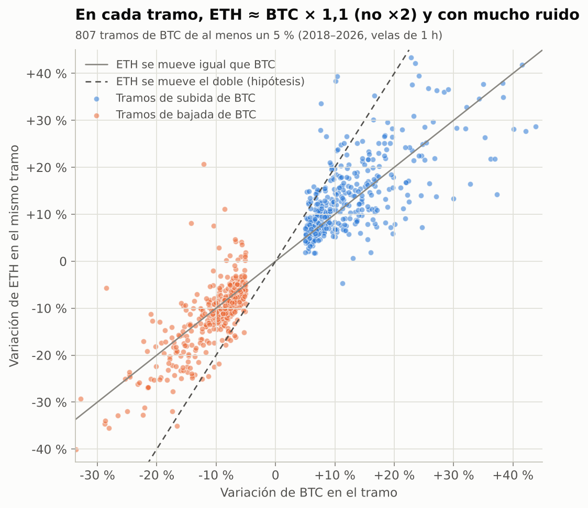
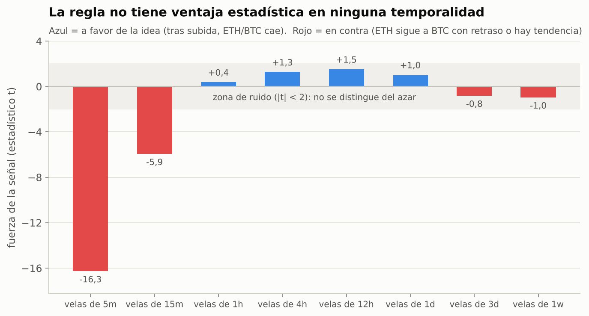
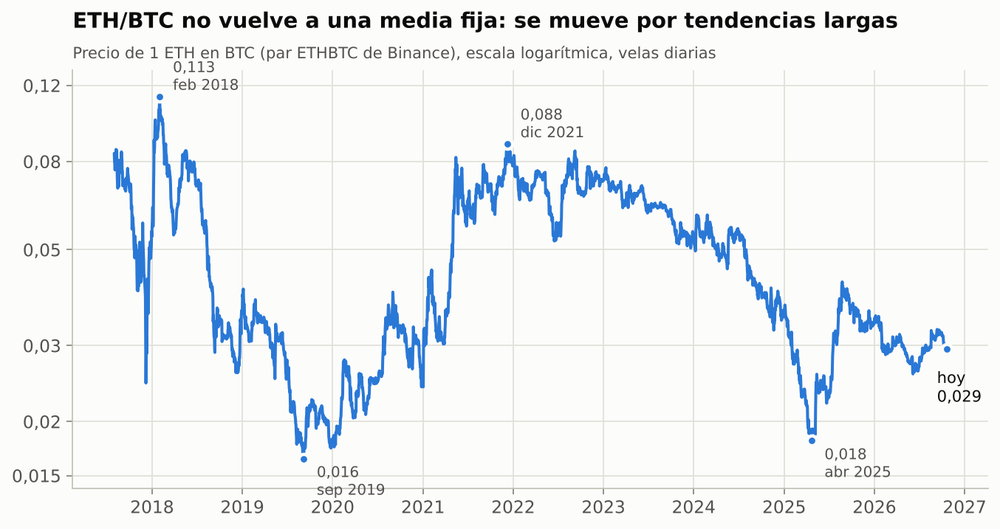
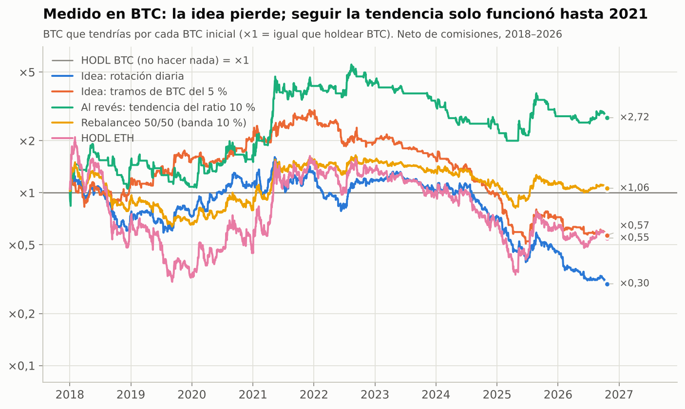
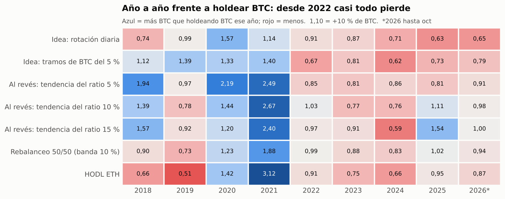

# Bot de rotación por correlación (BTC ↔ ETH): análisis inicial y validación con datos

*Fecha: 22 de octubre de 2026 · Datos: Binance spot, enero 2018 – 21 octubre 2026 · Todo el código y los resultados se pueden reproducir (ver final del documento).*

---

## 0. Resumen en 30 segundos

**Veredicto: la regla tal y como está planteada no tiene recorrido. Los datos la descartan con claridad.** La idea sirve de punto de partida, y el método y la infraestructura para validarla ya están montados en este repositorio.

| Premisa de la idea | ¿Se cumple? | Dato clave |
|---|---|---|
| BTC y ETH están muy correlacionados | ✅ Sí | Es el par más correlacionado del top 20 (0,83) y el más estable |
| ETH amplifica a BTC (sube el doble y baja el doble) | ❌ No | Beta ≈ 1,1 (no 2), y asimétrica: amplifica más las **bajadas** (1,22) que las subidas (0,95) |
| Tras una subida viene una bajada (los tramos se alternan de forma predecible) | ❌ No | Ninguna temporalidad entre 1 h y 1 semana muestra señal estadística. A 5–15 min ocurre lo contrario |
| El ratio ETH/BTC vuelve a su media | ❌ No | No están cointegrados: el ratio pasó de 0,113 a 0,016, luego a 0,088, después a 0,018 y hoy está en 0,029 |

**Backtest (2018–2026, con comisiones), medido en BTC frente a "no hacer nada y quedarse en BTC" (HODL BTC):**

- Regla literal con velas diarias: acabas con **0,29 BTC por cada BTC** que habrías tenido sin hacer nada (−71 %).
- Regla por tramos de un 5 % de BTC: **0,57** (−43 %). Con velas de 1 hora la cartera se queda prácticamente a cero, porque las comisiones se comen ~445 % del capital al año.
- He probado 35 variantes de la idea (8 temporalidades y 27 combinaciones de tramos y umbrales) y **34 pierden frente a HODL BTC**. La única que no pierde hace 3 operaciones en 9 años. En 12 pares de tokens distintos, la regla literal pierde siempre frente a un simple rebalanceo 50/50.

**Lo interesante:** la estrategia **al revés** (quedarse en el token que va ganando y cambiar cuando el ratio gira un X %) sí tuvo ventaja real hasta 2021. Multiplicó por 2,7–4,5 los BTC y supera al azar en el 96–99,8 % de los casos. **Pero desde 2022 también pierde** frente a HODL BTC, igual que el rebalanceo 50/50. Desde 2022 nada que mantenga ETH parte del tiempo gana a quedarse en BTC.

**Recomendación:** no construir el bot todavía. Antes, una fase corta de investigación sobre 2–3 variantes con más fundamento (sección 6), con criterios de validación estrictos fijados de antemano.

---

## 1. Qué apuesta realmente el bot

La regla propuesta: *tras una subida, mover el capital a BTC; tras una bajada, moverlo a ETH*.

Hay una identidad matemática que simplifica todo el análisis. Si siempre estás 100 % en BTC o 100 % en ETH, entonces, **medido en BTC**:

> resultado frente a HODL BTC = (cuánto sube o baja el ratio ETH/BTC **mientras estás en ETH**) × (1 − coste)^nº de cambios

Es decir, el bot no gana por "la diferencia de porcentajes de subida" en sí. Gana **solo si acierta cuándo el ratio ETH/BTC va a subir**, y paga comisión en cada cambio. Como ETH suele moverse algo más que BTC, tras una subida del mercado el ratio normalmente ha subido. La regla apuesta entonces a que **el ratio se dará la vuelta en el siguiente tramo** (reversión a la media).

El ejemplo de la idea (BTC +1 % y ETH +2 % en la subida, y lo inverso en la bajada) solo da dinero si sabes *de antemano* que viene una bajada. Si después de la subida viene otra subida, estás en BTC y te pierdes el extra de ETH.

Productos existentes equivalentes (en Pionex y Binance):

| Producto | Relación con la idea |
|---|---|
| **Bot de rebalanceo** (Pionex, dos monedas 1:1, por umbral o periódico) | Versión "suave" de la misma apuesta: vende un poco del que sube y compra del que baja |
| **Grid sobre el par ETH/BTC** | La misma apuesta de reversión, en varios niveles de precio |
| **Rebalanceo por momentum** (Pionex mueve todo a la moneda que mejor va) | Justo **la apuesta contraria**: quedarse con la que gana |
| **Pairs trading** (largo uno / corto otro) | Versión neutral al mercado. Requiere derivados y que el par esté cointegrado |

---

## 2. Datos y método

- **Fuente:** ficheros históricos oficiales de Binance (`data.binance.vision`), sin API key.
- **Universo:** 20 tokens líquidos con par USDT (BTC, ETH, BNB, SOL, XRP, ADA, DOGE, TRX, LINK, AVAX, DOT, LTC, BCH, XLM, ATOM, ETC, NEAR, UNI, FIL, AAVE) más 8 pares cruzados directos (ETHBTC, SOLBTC, BNBBTC…). Velas diarias y de 1 hora desde 2017, y de 5 minutos para BTC y ETH (~1 millón de velas cada uno).
- **Costes por cambio de posición:** 0,075 % de comisión (Binance pagando con BNB) + 0,02 % de deslizamiento (el tick del par ETHBTC es ≈0,03 % del precio), es decir ~0,095 %. También se prueban sin costes, con 0,05 % (tipo Pionex) y pasando por USDT (dos operaciones, ~0,19 %).
- **Sin mirar al futuro:** la señal se calcula al cierre de la vela y la operación se hace en la siguiente. Hay tests automáticos que lo comprueban (`tests/`).
- **Métrica principal:** BTC que tienes al final frente a quedarte en BTC. Es la forma justa de medir una rotación entre dos criptos, porque en dólares cualquier estrategia sube o baja con el mercado.

---

## 3. ¿Se cumplen las premisas?

### 3.1 Correlación: sí, BTC–ETH es el mejor par

De los 190 pares posibles entre los 20 tokens, BTC–ETH es el más correlacionado (0,83 en rentabilidades diarias, últimos 2 años). Además es el más **estable**: desde 2021 su correlación a 90 días nunca bajó de 0,58. Otros pares "muy correlacionados" se descorrelacionan por completo en algunos momentos (BTC–SOL llegó a 0,08 y BTC–DOGE a 0,05).

| Par | Correlación (2 años) | Mínimo de la correlación a 90 días desde 2021 |
|---|---|---|
| BTC–ETH | 0,83 | 0,58 |
| LINK–AVAX | 0,82 | 0,27 |
| ETH–LINK | 0,81 | 0,35 |
| ETH–SOL | 0,81 | 0,12 |
| BTC–SOL | 0,80 | 0,08 |

### 3.2 Amplificación: mucho menor de lo supuesto, y en contra



- La **beta** de ETH respecto a BTC (cuánto se mueve ETH por cada 1 % de BTC) es **1,09** en el conjunto del periodo, no 2. Varía mucho: de 0,7 a 2,2 en ventanas de 90 días, y en 2023–2024 estuvo **por debajo de 1**.
- Es **asimétrica**: en días de subida de BTC la beta es 0,95; en días de bajada, 1,22 (diferencia con t = −5,5, muy significativa). ETH amplifica más las caídas que las subidas. Se repite en 8 de los 9 años.

Por tramos de mercado (giros de BTC de al menos un X %):



| Tramos de BTC de… | Amplificación mediana en subidas | % de subidas en que ETH sube más | Amplificación mediana en bajadas | % de bajadas en que ETH cae más |
|---|---|---|---|---|
| 2 % | 1,08 | 57 % | 1,10 | 60 % |
| 5 % | 1,09 | 60 % | 1,13 | 63 % |
| 10 % | 1,02 | 52 % | 1,15 | 64 % |
| 20 % | 0,99 | 49 % | 1,10 | 62 % |

En los tramos grandes de subida, que ETH suba más que BTC es **cara o cruz** (49–52 %). En cambio, en las bajadas ETH cae más el 62–64 % de las veces.

### 3.3 Predictibilidad: la clave, y no está

Esta es la premisa que de verdad importa. Para cada temporalidad, mido cuánto se mueve el ratio ETH/BTC en la vela **siguiente** según si BTC subió o bajó en la actual:



| Velas de | Ventaja de la regla por vela | Fuerza (t) | Coste por vela (0,1 %/cambio) |
|---|---|---|---|
| 5 min | −0,26 pb | −16,3 | 5,2 pb |
| 15 min | −0,27 pb | −5,9 | 5,3 pb |
| 1 h | +0,07 pb | +0,4 | 5,4 pb |
| 4 h | +0,90 pb | +1,3 | 5,4 pb |
| 12 h | +3,27 pb | +1,5 | 5,2 pb |
| 1 día | +4,56 pb | +1,0 | 5,4 pb |
| 3 días | −11,2 pb | −0,8 | 5,2 pb |
| 1 semana | −30,2 pb | −1,0 | 5,2 pb |

*(pb = puntos básicos; 1 pb = 0,01 %)*

- **Entre 1 h y 1 semana no hay señal**: todos los valores |t| < 2, que es lo que saldría por puro azar. Y en todas las temporalidades **el coste por vela supera a la ventaja estimada**.
- **A 5–15 minutos ocurre lo contrario** de la idea, y con mucha fuerza: cuando BTC se mueve, ETH le sigue con unos minutos de retraso. Es un efecto real, pero lo explotan bots de alta frecuencia con comisiones casi nulas y latencias de milisegundos. A esa frecuencia tú harías 54.000 cambios al año.
- **A plazos largos (semanas) el ratio tiende a seguir su tendencia**, no a revertir. El *variance ratio* del ratio ETH/BTC a 30 días es 1,37 (z = 2,3). Un valor > 1 significa tendencia y < 1 reversión.

Hay además un problema de **potencia estadística**. El ratio ETH/BTC tiene una volatilidad de ~48 % anual. Para distinguir del azar una ventaja de, por ejemplo, un 10 % anual en una estrategia que está la mitad del tiempo en ETH, harían falta **décadas de datos**. Por eso un backtest bonito de este tipo de rotación es muy fácil de conseguir por suerte.

### 3.4 Cointegración: no hay "media" a la que volver



Correlación alta no es lo mismo que **cointegración**. La correlación mide si se mueven juntos *día a día*; la cointegración, si sus precios están "atados" a largo plazo. Para apostar a que el ratio vuelve, se necesita la segunda.

- Test de Engle-Granger sobre ventanas móviles de 90, 180 y 365 días: el par sale cointegrado solo en el **6–8 %** de las ventanas. Es lo mismo que daría el azar (5 %).
- La "vida media" estimada del spread crece con el tamaño de la ventana (8 → 18 → 37 días), que es la firma de un ratio que **no** revierte.
- Entre 2022 y 2026 ETH perdió un 63 % frente a BTC, con rebotes por el camino.

---

## 4. Backtests

### 4.1 Regla literal por temporalidad

BTC final por cada BTC de HODL BTC (1,00 = igual que no hacer nada):

| Velas de | Sin costes | 0,05 % (tipo Pionex) | 0,075 % (Binance+BNB) | Vía USDT | Cambios/año | Comisiones/año (% capital) |
|---|---|---|---|---|---|---|
| 5 min | 0,00 | 0,00 | 0,00 | 0,00 | 54.267 | 5.155 % |
| 15 min | 0,01 | 0,00 | 0,00 | 0,00 | 18.414 | 1.749 % |
| 1 h | 0,97 | 0,00 | 0,00 | 0,00 | 4.683 | 445 % |
| 4 h | 1,75 | 0,00 | 0,00 | 0,00 | 1.188 | 113 % |
| 12 h | 2,10 | 0,20 | 0,09 | 0,00 | 379 | 36 % |
| 1 día | 1,49 | 0,44 | **0,29** | 0,06 | 196 | 19 % |
| 3 días | 0,39 | 0,26 | 0,23 | 0,14 | 63 | 6 % |
| 1 semana | 0,28 | 0,24 | 0,22 | 0,18 | 27 | 3 % |

Los resultados "bonitos" sin costes a 4 h–1 día no son estadísticamente distinguibles del azar (sección 3.3) y las comisiones se los comen varias veces.

### 4.2 Regla por tramos (cambiar tras un movimiento de X %)

Operar por tramos en lugar de por velas reduce mucho los cambios. Resultado neto frente a HODL BTC:

| Umbral | Idea: tramos de BTC | Idea: tramos del ratio | **Al revés**: tendencia del ratio | Cambios/año (al revés) |
|---|---|---|---|---|
| 2 % | 0,01 | 0,02 | 0,85 | 219 |
| 3 % | 0,11 | 0,06 | 1,23 | 121 |
| 5 % | 0,57 | 0,05 | **4,51** | 51 |
| 7,5 % | 0,31 | 0,28 | 1,04 | 30 |
| 10 % | 0,35 | 0,13 | 2,72 | 17 |
| 15 % | 0,20 | 0,13 | 3,31 | 8 |
| 20 % | 0,11 | 0,26 | 1,64 | 5 |

Referencias en el mismo periodo (en dólares): HODL BTC ×6,2 · HODL ETH ×3,4 · 50/50 sin tocar ×4,8 · **rebalanceo 50/50 con banda del 10 %: ×6,6** (1,06 frente a HODL BTC, solo ~2 operaciones al año). Todas, también las rotaciones, sufren en algún momento caídas de al menos un 80 % en dólares. Rotar entre dos criptos no protege de los mercados bajistas.

### 4.3 ¿Es real la ventaja de la versión "al revés"? Solo hasta 2021





Cuatro pruebas de robustez:

1. **Test de azar:** se mezclan al azar los periodos de tenencia, con el mismo número de cambios y las mismas duraciones (2.000 simulaciones). La versión "al revés" queda por encima del 96–99,8 % de las simulaciones. **Su *timing* no fue suerte en el conjunto 2018–2026.** La idea original (tramos de BTC del 5 %) queda en el percentil 74, indistinguible del azar.
2. **Por años:** toda la ventaja viene de 2018–2021. Desde 2022, la tendencia del ratio al 5 % pierde todos los años.
3. **Fecha de inicio:** empezando en 2022, 2023 o 2024, **todas** las variantes pierden frente a HODL BTC (pequeñas diferencias con otras tablas por cómo se muestrean las velas):

   | Inicio | Ratio ETH/BTC | Idea diaria | Idea tramos 5 % | Al revés 5 % | Al revés 10 % | Al revés 15 % | Rebalanceo 50/50 |
   |---|---|---|---|---|---|---|---|
   | 2018 | 0,55 | 0,30 | 0,57 | 4,51 | 2,72 | 3,31 | 1,06 |
   | 2020 | 1,64 | 0,41 | 0,36 | 2,28 | 2,51 | 2,28 | 1,49 |
   | 2022 | 0,37 | 0,23 | 0,19 | 0,43 | 0,65 | 0,85 | 0,69 |
   | 2024 | 0,54 | 0,29 | 0,36 | 0,65 | 0,89 | 0,90 | 0,79 |

4. **Walk-forward** (elegir a ciegas cada 1 de enero la mejor de 35 configuraciones según los 2 años anteriores): gana mucho en 2020–2021 (×2,19 y ×2,49). Desde 2022 el producto es **0,62**, es decir, pierde un 38 % frente a HODL BTC. El parámetro que "mejor funcionaba" cambia casi todos los años, señal clara de sobreajuste.

### 4.4 Otros pares (2021–2026)

Resultado frente a HODL del activo "tranquilo" (A). La referencia neutral justa es el **rebalanceo 50/50**:

| Par (B/A) | Variación B/A | Rebalanceo 50/50 | Idea diaria | Idea tramos 5 % | Al revés 10 % | Al revés 15 % |
|---|---|---|---|---|---|---|
| ETH/BTC | 1,16 | 1,28 | 0,26 | 0,27 | 1,81 | 2,08 |
| SOL/BTC | 23,9 | 8,89 | 1,84 | 3,16 | 4,68 | 12,0 |
| SOL/ETH | 20,6 | 7,18 | 1,76 | 9,60 | 8,39 | 8,15 |
| BNB/BTC | 6,88 | 3,49 | 2,08 | 1,70 | 6,24 | 3,42 |
| XRP/BTC | 2,12 | 2,27 | 0,27 | 1,55 | 0,91 | 1,05 |
| DOGE/BTC | 6,04 | 5,51 | 1,00 | 0,11 | 2,15 | 7,21 |
| LTC/BTC | 0,17 | 0,51 | 0,07 | 0,30 | 0,22 | 0,13 |
| LINK/BTC | 0,38 | 0,88 | 0,38 | 0,53 | 0,47 | 0,22 |
| LINK/ETH | 0,33 | 0,73 | 0,29 | 1,48 | 0,53 | 0,50 |
| ADA/XRP | 0,20 | 0,76 | 0,08 | 0,82 | 0,99 | 0,44 |
| BCH/BTC | 0,29 | 0,75 | 0,14 | 0,14 | 0,55 | 0,63 |
| ADA/BTC | 0,43 | 0,93 | 0,26 | 1,15 | 1,25 | 2,22 |

- La **idea literal pierde frente al rebalanceo 50/50 en los 12 pares**.
- La versión "al revés" gana al rebalanceo en 5 de los 12 pares, tanto con el 10 % como con el 15 %: cara o cruz.
- Fuera de BTC–ETH muchos pares no son "sólidos": LTC, BCH, LINK y ADA pierden entre un 57 % y un 83 % frente a BTC en el periodo.

---

## 5. Diagnóstico: cómo lo vería un equipo de bots tipo Pionex

**Por qué falla la idea:**

1. **Exige predecir la dirección del siguiente tramo**, y el mercado no lo regala a las escalas en que las comisiones permiten operar.
2. **La "amplificación" es pequeña (~10 %) y asimétrica en contra**: ETH no sube el doble; cae algo más de lo que sube.
3. **Correlación ≠ cointegración**: dos tokens pueden moverse juntos día a día y aun así separarse durante años (ETH/BTC −63 % desde 2022).
4. **Las comisiones escalan con la frecuencia**: estar todo dentro o todo fuera cuesta un 0,1 % por cambio. Con cientos de cambios al año, eso se come cualquier ventaja.
5. **Dependencia del régimen**: lo que funcionó en 2018–2021 dejó de funcionar.

**Cómo diseña un equipo profesional los bots que vende:** se apoya en fuentes de rentabilidad **estructurales**, no en predicciones. Ejemplos: el grid cobra la volatilidad en mercados laterales, el arbitraje spot-futuros cobra la financiación, el rebalanceo cobra la volatilidad del ratio y el market making cobra el spread. Su trabajo está en el riesgo y la ejecución. Tu idea, en su versión robusta, ya existe como producto (bot de rebalanceo y grid ETH/BTC), y los datos muestran sus límites.

**Lo que sí tiene recorrido** (ordenado por mi preferencia):

| Línea | Por qué | Riesgo principal |
|---|---|---|
| **A. Momentum relativo multi-activo** (rotar hacia los 1–3 tokens más fuertes de una cesta de 5–10 grandes, con filtro de régimen) | Es lo único con ventaja estadística histórica (96–99,8 % frente al azar) y la literatura académica documenta momentum en cripto (Liu y Tsyvinski) | La ventaja desapareció desde 2022 en BTC/ETH. Hay que validar fuera de muestra con muchos activos |
| **B. Gestión del riesgo en dólares** (estado "fuera" en USDT con un filtro de tendencia del mercado) | El riesgo real para ti no es el ratio ETH/BTC, sino caídas del 80–95 % en dólares | Las señales de tendencia también fallan en mercados laterales |
| **C. Rebalanceo 50/50 como núcleo** | Robusto, ~2 operaciones al año, cobra la volatilidad del ratio (×6,6 frente a ×4,8 sin rebalancear) | No te protege si uno de los dos se hunde frente al otro durante años |
| D. Pairs trading neutral (largo/corto con futuros) | Elimina la dirección del mercado | El par no está cointegrado: alto riesgo de que el spread no vuelva, más los costes de financiación |
| E. Lead-lag de minutos (BTC adelanta a ETH) | El efecto existe (t = −16) | Requiere infraestructura de alta frecuencia y comisiones de maker VIP. No es para nosotros |

---

## 6. Hoja de ruta por fases

Cada fase termina con una decisión **sigue / no sigue** con criterios fijados *antes* de ver los resultados.

| Fase | Contenido | Duración orientativa | Criterio para pasar |
|---|---|---|---|
| **0. Validación inicial** ✅ *(este documento)* | Hipótesis, datos, tests estadísticos, backtests con costes | Hecho | **No sigue** la regla original. **Sigue** la investigación de variantes |
| **1. Investigación de variantes** | Formalizar 2–3 hipótesis (A, B, C). Reservar **2025–2026 como datos que no se tocan** hasta el final. Validar en varias cestas de tokens | 2–3 semanas | Neto de costes bate a HODL BTC **y** al rebalanceo 50/50 en walk-forward; gana en ≥60 % de los años y en ≥2/3 de los activos; percentil ≥95 % frente al azar; parámetros vecinos también funcionan; caída máxima aceptable para ti |
| **2. Motor de backtest realista** | Simulador por eventos que usa **el mismo código que el bot en vivo**: órdenes límite/mercado, ejecuciones parciales, tamaños mínimos y redondeos del exchange, caídas de API | 1–2 semanas | Reproduce los resultados de la fase 1 con una diferencia < 10 % |
| **3. Paper trading** | Bot en vivo con datos reales y órdenes simuladas (o testnet) | 4–8 semanas | Las desviaciones frente al backtest se explican; sin incidencias operativas graves |
| **4. Real con poco capital** | Capital pequeño (el que estés dispuesto a perder), alertas, *kill switch* | 2–3 meses | Comportamiento coherente con el paper trading; costes reales ≈ supuestos |
| **5. Escalar y operar** | Más capital/activos, informes, revalidación periódica (las estrategias se degradan) | Continuo | Revisión trimestral; se apaga si se sale de los rangos esperados |

**Arquitectura propuesta del bot** (fases 2–5), la habitual en un bot profesional:

```
Datos de mercado (WebSocket + REST de respaldo, relleno de huecos)
        │
Motor de señales (función pura: estado + vela nueva → posición objetivo)
        │
Gestor de riesgo (límites de posición/pérdida diaria/nº de cambios, datos obsoletos,
        │          spread anómalo, circuit breaker)
        │
Ejecución / OMS (objetivo → órdenes; post-only con timeout y paso a mercado; IDs
        │        idempotentes; reconciliación de saldos al arrancar y periódica)
        │
Persistencia (SQLite/Postgres: estado, órdenes, ejecuciones, PnL) + export fiscal
        │
Monitorización (alertas por Telegram, informe diario, heartbeat, parada de emergencia)
```

Tecnología: Python, `ccxt` o el SDK oficial del exchange, `asyncio`, Docker en un VPS. Las claves de API van **sin permiso de retirada** y con IP en lista blanca.

---

## 7. Riesgos a tener en cuenta

- **Modelo:** sobreajuste (probar muchas variantes y quedarse con la mejor), cambio de régimen, sesgo de supervivencia (elegir hoy tokens "sólidos" mirando el pasado; LUNA o FTT también lo parecían).
- **Operativos:** fallos de API, ejecuciones parciales, mantenimientos del exchange, bugs. Un bot que cambia de posición en bucle puede hacer mucho daño en minutos.
- **Contraparte:** el dinero está en el exchange (recuerda FTX). Conviene usar exchanges autorizados en la UE y no dejar más capital del necesario.
- **Fiscalidad en España (importante para un bot de rotación):** cada cambio BTC↔ETH es una **permuta** que genera ganancia o pérdida patrimonial en el IRPF aunque no pases por euros (consulta vinculante DGT V0999-18; art. 37.1.h LIRPF). Con decenas o cientos de cambios al año hay que llevar un registro FIFO de cada operación. Además, con la directiva DAC8 los exchanges informan a Hacienda desde 2026. **Consúltalo con un asesor fiscal.**

---

## 8. Dudas que necesito que me aclares

1. **¿Cuál es el objetivo?** ¿Acabar con más BTC, con más euros, o con menos riesgo (caídas menores)? Cambia completamente qué estrategia tiene sentido y contra qué se compara.
2. **¿Qué exchange quieres usar?** (Pionex, Binance, Bybit, Kraken…). Afecta a comisiones, pares directos y calidad de la API.
3. **Capital aproximado y caída máxima tolerable** (por ejemplo, ¿aguantarías ver −50 % en euros?).
4. **¿Solo spot, o también futuros/margen?** Sin derivados no hay versión neutral al mercado.
5. **¿Qué duración imaginabas para un "tramo"?** ¿Horas, días, semanas?
6. **¿Tributas en España?** Por el punto fiscal anterior.
7. **¿Programas tú (Python) y quieres mantenerlo, o prefieres que yo desarrolle y tú supervises?**
8. **¿Te parece bien pivotar** hacia las líneas A/B/C de la sección 5 para la fase 1?

---

## 9. Cómo reproducir este análisis

```bash
python3 -m venv .venv && source .venv/bin/activate
pip install -r requirements.txt
python scripts/download_data.py        # ~200 MB en data/ (no se sube a git)
python scripts/explore.py              # premisas → results/*.csv + docs/img/01-04
python scripts/backtest_rotation.py    # backtests → results/bt_*.csv + docs/img/05-06
python -m pytest -q                    # tests del backtester (incluye "no mirar al futuro")
```

Todos los números de este documento salen de los CSV de `results/`.

## Referencias

- Datos: [Binance Public Data](https://data.binance.vision).
- Liu, Y. y Tsyvinski, A., *Risks and Returns of Cryptocurrency* ([NBER w24877](https://www.nber.org/system/files/working_papers/w24877/w24877.pdf); publicado en *Review of Financial Studies*, 2021): documentan un fuerte efecto de momentum temporal en criptomonedas.
- Fil, M. y Kristoufek, L. (2020), *Pairs Trading in Cryptocurrency Markets*, IEEE Access 8: resultados de pairs trading muy dependientes del periodo y del método ([resumen en una tesis](https://thesis.eur.nl/pub/67552/Thesis-Pairs-trading-.pdf)).
- Lo, A. y MacKinlay, C. (1988), *Stock Market Prices Do Not Follow Random Walks*: el test de ratio de varianzas usado en la sección 3.3.
- Pionex, [Rebalancing Bot](https://intercom.help/pionexus/en/articles/14319692-rebalancing-bot) y [FAQ](https://intercom.help/pionex/en/articles/15241901-rebalancing-bot-faq) (incluye el rebalanceo por momentum).
- DGT, consulta vinculante V0999-18 sobre permutas entre criptomonedas ([texto](https://www.elnotario.es/images/pdf/DGT-N80-05-V0999-18.pdf); [análisis de Osborne Clarke](https://www.osborneclarke.com/es/insights/la-tributacion-de-las-criptomonedas-con-arreglo-a-la-doctrina-de-la-direccion-general-de-tributos)).
- Comisiones: Binance spot 0,1 % (0,075 % pagando con BNB); Pionex 0,05 % según [esta reseña](https://www.daytrading.com/pionex-vs-topfx). Verifícalas en la web de cada exchange, porque cambian.
