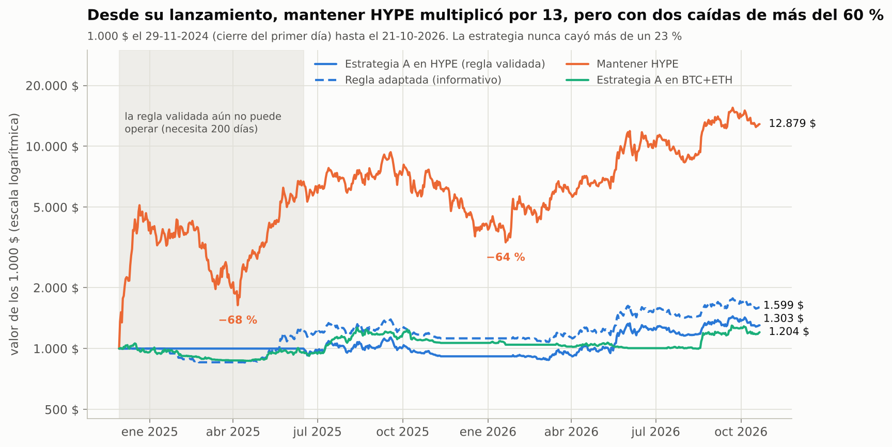

# Estrategia A con HYPE (1.000 $): 2026 y desde su lanzamiento

*22 de octubre de 2026 · Datos diarios del par spot HYPE/USDC de Hyperliquid (cotiza desde el 29 de noviembre de 2024).*

## En 2026 (del 1 de enero al 21 de octubre)

| Con 1.000 $ desde el 1 de enero | Valor el 21 oct | Rentabilidad | Peor caída | Órdenes | Invertido de media |
|---|---|---|---|---|---|
| **Estrategia A en HYPE (regla validada)** | **1.424 $** | **+42 %** | **−13 %** | 25 | 36 % |
| Mantener HYPE | 3.166 $ | +217 % | −30 % | 1 | 100 % |
| *Misma regla sin límite de volatilidad (informativo)* | *1.658 $* | *+66 %* | *−29 %* | *25* | *76 %* |
| *Estrategia A en BTC+ETH, mismo periodo (referencia)* | *1.136 $* | *+14 %* | *−9 %* | *52* | *34 %* |


- **En 2026 HYPE se ha más que triplicado** (de 25,43 $ a 80,64 $). En un año así, mantener gana con mucha diferencia.
- **La estrategia invierte poco en HYPE porque es muy volátil.** Su volatilidad mediana en 2026 es del 83 % anual, entre el 49 % y el 137 %. Con el límite del 40 %, incluso con las tres medias a favor invierte como mucho la mitad del dinero. Sin ese límite habría ganado +66 %, pero con el doble de caída.
- **Opera poco:** 25 órdenes en casi 10 meses, de unos 180 $ de importe típico (entre 100 $ y 371 $). Pagó 7 $ en comisiones y deslizamiento. Estuvo todo en USDT en enero, hasta que HYPE recuperó sus medias.

**Las órdenes a la vez y los saldos a fin de mes** están en `results/hype_2026/`.

## Contexto: el punto de partida importa

- **El 1 de enero HYPE venía de un desplome.** Hizo máximo en 58,60 $ el 18 de septiembre de 2025 y tocó 20,97 $ el 20 de enero de 2026: −64 %. Empezar el 1 de enero es empezar casi en el suelo, lo que favorece a mantener.
- **Desde el primer día con 200 días de historia (16 de junio de 2025):**
  - la estrategia lleva 1.000 $ a 1.303 $, con una peor caída del −23 %;
  - mantener lleva 1.000 $ a 1.925 $, pero con una caída del −64 %, por encima de tu límite del −50 %.
- **Del máximo de septiembre de 2025 al 31 de diciembre:** la estrategia perdió un 19 %; mantener, un 57 %.

## Desde el lanzamiento (lo más cerca de "2 años" que permite HYPE)

HYPE empezó a cotizar el 29 de noviembre de 2024, hace unos 23 meses. La regla validada necesita 200 días de precios, así que no puede operar hasta el 16 de junio de 2025. Hasta entonces deja el dinero en USDT. Como informativo, una versión adaptada usa las medias que ya existen en cada momento: la de 50 días desde enero de 2025, la de 100 desde marzo y las tres desde junio.

| 1.000 $ desde el 29-11-2024 | Valor el 21 oct 2026 | Rentabilidad | Peor caída | Órdenes | Invertido de media |
|---|---|---|---|---|---|
| **Estrategia A en HYPE (regla validada)** | **1.303 $** | **+30 %** | **−23 %** | 55 | 23 % |
| *Regla adaptada a una moneda joven (informativo)* | *1.599 $* | *+60 %* | *−23 %* | *72* | *27 %* |
| Mantener HYPE | 12.879 $ | +1.188 % | −68 % | 1 | 100 % |
| *Estrategia A en BTC+ETH, mismo periodo (referencia)* | *1.204 $* | *+20 %* | *−21 %* | *164* | — |
| *Estrategia A en BTC+ETH, 2 años exactos desde el 21-10-2024* | *1.492 $* | *+49 %* | *−21 %* | *173* | — |
| *Mantener BTC+ETH, 2 años exactos* | *1.086 $* | *+9 %* | *−60 %* | — | — |



- **Mantener HYPE desde el primer día multiplicó por 13**, pero con dos desplomes por encima de tu límite del −50 %:
  - del 21-12-2024 (32,03 $) al 6-4-2025 (10,25 $): −68 %;
  - del 18-9-2025 (58,60 $) al 20-1-2026 (20,97 $): −64 %.
- **La estrategia nunca cayó más de un 23 %**, pero solo capturó una parte pequeña de la subida. HYPE es tan volátil que, con el límite del 40 %, la regla invierte de media un 23–27 % del dinero.
- **Comprar en el lanzamiento exigía usar Hyperliquid** (exchange descentralizado, con cartera propia). En OKX, HYPE cotiza en spot desde noviembre de 2025 y en futuros desde febrero de 2025.
- **En los 2 años exactos, la estrategia en BTC+ETH (+49 %) superó a la estrategia en HYPE**, con una caída parecida (−21 % frente a −23 %).

## Cautelas

- **Solo una moneda y poca historia** (10 meses en 2026; 23 meses desde el lanzamiento). Es una ilustración, no una validación.
- **HYPE se elige hoy porque ha subido** (está en el top 10 actual). En el estudio del top 10, añadir altcoins a BTC y ETH empeoró el resultado una vez quitado ese sesgo. En la validación, la mejora de la rentabilidad ajustada al riesgo frente a mantener no se cumplió en las altcoins (criterio 4); la reducción de caídas sí.
- **Disponibilidad:** según la API pública de OKX, cotiza HYPE en spot (HYPE-USDT desde noviembre de 2025 y HYPE-EUR desde diciembre de 2025). Hay que confirmarlo en OKX Europa.
- **Liquidez:** se han supuesto los mismos costes que en BTC y ETH (0,15 % por operación). En HYPE el diferencial entre compra y venta puede ser mayor.
- **Datos:** los de Hyperliquid coinciden con los de OKX (609 días en común, diferencia media del 0,06 %) y con los de Binance (28 días, 0,07 %).

## Reproducir

```bash
python scripts/hype_2026.py   # descarga HYPE de Hyperliquid → results/hype_2026/, gráficos 21 y 22
```
