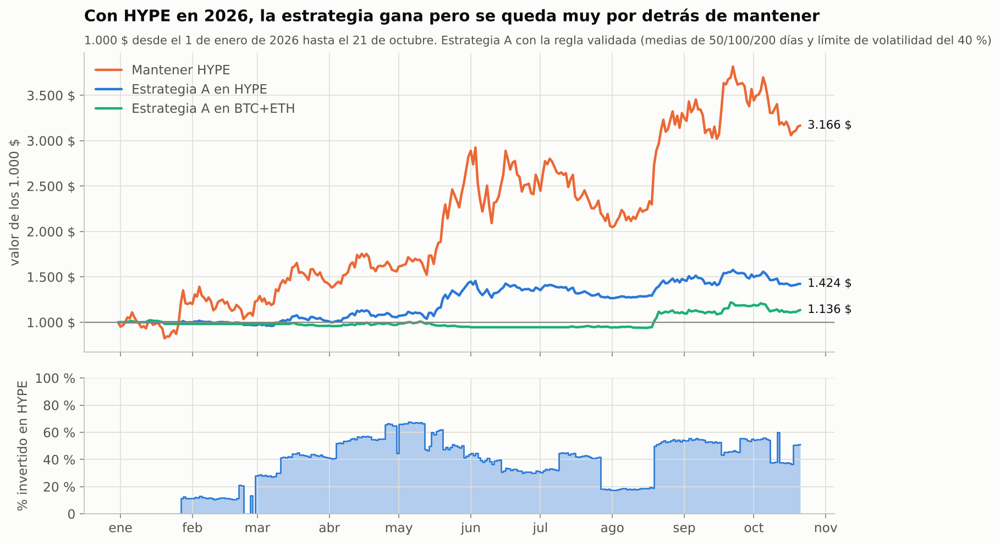

# Estrategia A con HYPE en 2026 (1.000 $)

*22 de octubre de 2026 · Del 1 de enero al 21 de octubre de 2026 · Datos diarios del par spot HYPE/USDC de Hyperliquid.*

## Resultado

| Con 1.000 $ desde el 1 de enero | Valor el 21 oct | Rentabilidad | Peor caída | Órdenes | Invertido de media |
|---|---|---|---|---|---|
| **Estrategia A en HYPE (regla validada)** | **1.424 $** | **+42 %** | **−13 %** | 25 | 36 % |
| Mantener HYPE | 3.166 $ | +217 % | −30 % | 1 | 100 % |
| *Misma regla sin límite de volatilidad (informativo)* | *1.658 $* | *+66 %* | *−29 %* | *25* | *76 %* |
| *Estrategia A en BTC+ETH, mismo periodo (referencia)* | *1.136 $* | *+14 %* | *−9 %* | *52* | *34 %* |



- **En 2026 HYPE se ha más que triplicado** (de 25,43 $ a 80,64 $). En un año así, mantener gana con mucha diferencia.
- **La estrategia invierte poco en HYPE porque es muy volátil.** Su volatilidad mediana en 2026 es del 83 % anual, entre el 49 % y el 137 %. Con el límite del 40 %, incluso con las tres medias a favor invierte como mucho la mitad del dinero. Sin ese límite habría ganado +66 %, pero con el doble de caída.
- **Opera poco:** 25 órdenes en casi 10 meses, de unos 180 $ de importe típico (entre 100 $ y 371 $). Pagó 7 $ en comisiones y deslizamiento. Estuvo todo en USDT en enero, hasta que HYPE recuperó sus medias.

**Las órdenes a la vez y los saldos a fin de mes** están en `results/hype_2026/`.

## Contexto: el punto de partida importa

- **El 1 de enero HYPE venía de un desplome.** Hizo máximo en 58,60 $ el 18 de septiembre de 2025 y tocó 20,97 $ el 20 de enero de 2026: −64 %. Empezar el 1 de enero es empezar casi en el suelo, lo que favorece a mantener.
- **Desde el primer día con 200 días de historia (16 de junio de 2025):**
  - la estrategia lleva 1.000 $ a 1.303 $, con una peor caída del −23 %;
  - mantener lleva 1.000 $ a 1.925 $, pero con una caída del −64 %, por encima de tu límite del −50 %.
- **Del máximo de septiembre de 2025 al 31 de diciembre:** la estrategia perdió un 19 %; mantener, un 57 %.

## Cautelas

- **Solo una moneda y unos 10 meses.** Es una ilustración, no una validación.
- **HYPE se elige hoy porque ha subido** (está en el top 10 actual). En el estudio del top 10, añadir altcoins a BTC y ETH empeoró el resultado una vez quitado ese sesgo. En la validación, la mejora de la rentabilidad ajustada al riesgo frente a mantener no se cumplió en las altcoins (criterio 4); la reducción de caídas sí.
- **Disponibilidad:** según la API pública de OKX, cotiza HYPE en spot (HYPE-USDT desde noviembre de 2025 y HYPE-EUR desde diciembre de 2025). Hay que confirmarlo en OKX Europa.
- **Liquidez:** se han supuesto los mismos costes que en BTC y ETH (0,15 % por operación). En HYPE el diferencial entre compra y venta puede ser mayor.
- **Datos:** los de Hyperliquid coinciden con los de OKX (609 días en común, diferencia media del 0,06 %) y con los de Binance (28 días, 0,07 %).

## Reproducir

```bash
python scripts/hype_2026.py   # descarga HYPE de Hyperliquid → results/hype_2026/, docs/img/21_hype_2026.png
```
