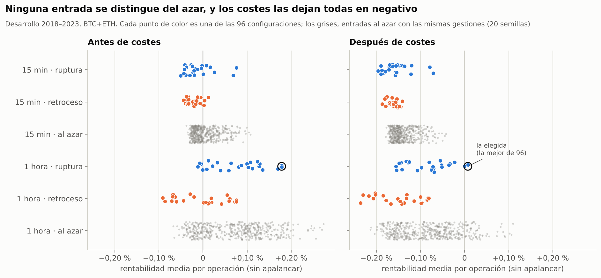
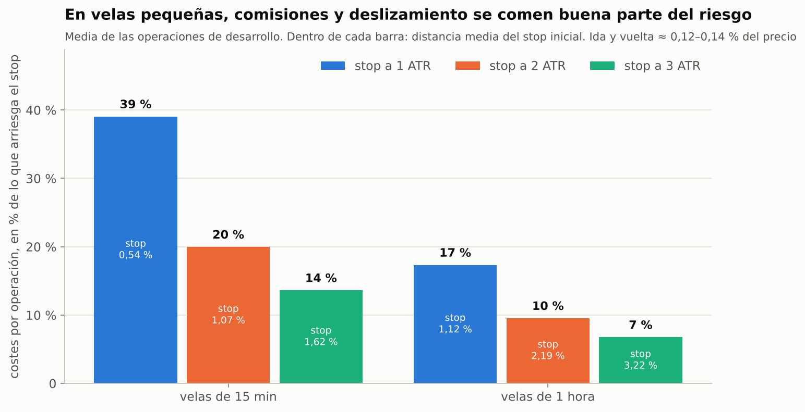
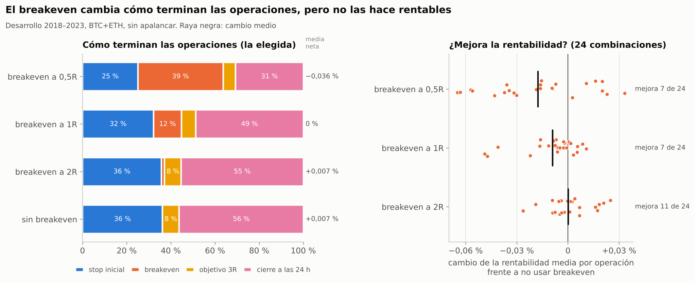
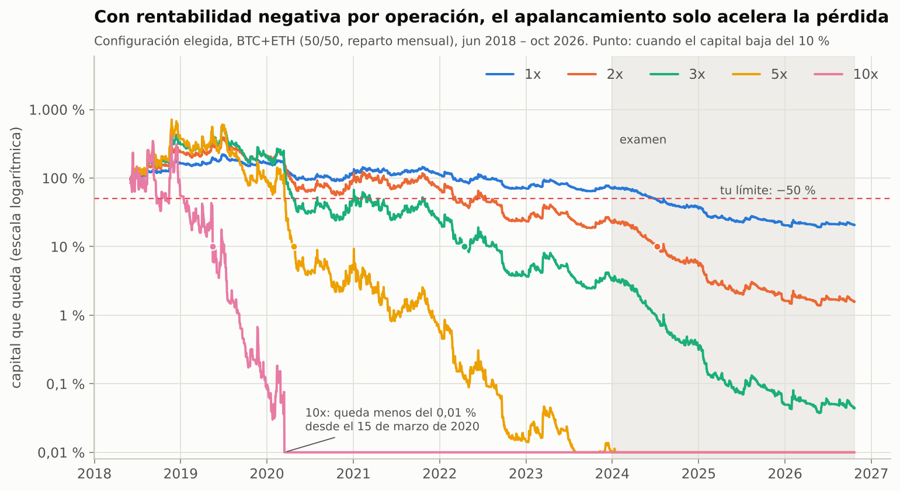

# Estrategia intradía con apalancamiento 10x y stop-loss escalonado

*Estado: **protocolo pre-registrado** (escrito y subido al repositorio antes de ejecutar ningún test de esta estrategia). Los resultados se añadirán debajo sin modificar esta sección.*

## Idea a evaluar (propuesta del usuario)

Operar BTC y ETH en temporalidades pequeñas con apalancamiento 10x, con una protección en varios pasos:
1. Stop-loss inicial a una distancia calculada con estadísticas del mercado.
2. Cuando la operación gana un cierto porcentaje, mover el stop a *breakeven* (precio de entrada), de forma que ya no pueda perder.
3. Dejar correr la ganancia hasta un objetivo o con un stop que la persiga.

**Aviso de partida.** Un esquema de stops y objetivos no crea ventaja por sí solo: si el precio se moviera al azar, cualquier combinación tendría valor esperado cero antes de costes. La ventaja tiene que venir de **cuándo se entra**, y la gestión sirve para aprovecharla mejor. Por eso se prueban entradas reales y entradas aleatorias con la misma gestión.

## Diseño (congelado)

**Activos y datos:** BTC y ETH. Velas de 5 minutos de Binance (spot, como aproximación al precio de los perpetuos) y funding real de los perpetuos de Binance.

**Filtro de tendencia diaria** (el de la estrategia A, conocido el cierre del día anterior). Solo largos si al menos 2 de las 3 medias de 50, 100 y 200 días están por debajo del precio. Solo cortos si ninguna lo está. En otro caso no se opera.

**Entradas** (señal al cierre de una vela de 15 minutos o de 1 hora; ejecución en la siguiente vela de 5 minutos):
- **Ruptura:**
  - Largo: el cierre supera el máximo de las 20 velas anteriores.
  - Corto: el cierre baja del mínimo de las 20 velas anteriores.
- **Retroceso:**
  - Largo: el cierre queda por debajo de la media exponencial de 20 velas menos 1 ATR (rango medio de 14 velas).
  - Corto: el cierre queda por encima de esa media más 1 ATR.
- **Aleatoria (control):** mismo filtro de tendencia. En cada vela se entra con la misma probabilidad media que la ruptura (20 semillas distintas).
- Una sola operación abierta por activo; las señales que llegan con una operación abierta se ignoran.

**Gestión en pasos:**
1. **Stop inicial** a k × ATR de la temporalidad de la señal, con k ∈ {1, 2, 3}.
2. **Breakeven:** cuando el precio avanza m × la distancia del stop, el stop pasa al precio de entrada más los costes, de modo que salir ahí deja ~0. m ∈ {0,5; 1; 2}, más una versión **sin breakeven** como control.
3. **Salida final**, dos variantes:
   - **(a) Objetivo** a 3 × la distancia del stop.
   - **(b) Stop que persigue:** una vez activado el breakeven (o a +1 distancia en la versión sin breakeven), sigue al mejor cierre a 1 × la distancia del stop, sin bajar nunca del breakeven.
4. **Cierre por tiempo** a las 24 horas.

Rejilla: 2 temporalidades × 2 entradas × 3 stops × 4 opciones de breakeven × 2 salidas = **96 configuraciones**.

**Ejecución y costes (futuros):**
- **Entrada:** a mercado, 0,05 % de comisión + 0,02 % de deslizamiento.
- **Stop y cierre por tiempo:** a mercado, 0,05 % + 0,02 %. En el stop se suma además un 10 % de lo que la vela haya atravesado el nivel.
- **Objetivo:** orden límite, 0,02 %.
- **Funding:** el real, cobrado cada 8 h sobre el nocional.
- **Ambigüedad dentro de una vela de 5 min:** si se tocan a la vez el stop y el objetivo (o el nivel del breakeven), se supone **el stop primero**. El breakeven y el stop que persigue se aplican desde la vela siguiente.

**Apalancamiento:** 10x sobre el capital de cada activo (50 % cada uno), con interés compuesto y margen aislado. **Liquidación** si el mínimo (o máximo, en cortos) de una vela alcanza el precio de liquidación antes de que se ejecute el stop (margen de mantenimiento 0,5 %). Una sub-cuenta liquidada recibe capital en el siguiente reparto mensual.

## Periodos

- **Desarrollo:** 1-6-2018 a 31-12-2023.
- **Examen final:** 1-1-2024 a 21-10-2026. Se ejecuta **una sola vez** con la configuración congelada.
- **Transparencia:** ya se han visto datos de todo el periodo para otras estrategias. En concreto, la estrategia B (comprar caídas en tendencia alcista) funcionó hasta 2024 y falló en 2025–2026. Para no sesgar la selección, la entrada de retroceso se incluye igualmente y la elección sigue la regla fijada aquí.

## Selección (fijada antes de ver resultados)

En desarrollo, entre las 96 configuraciones con al menos 150 operaciones (BTC+ETH), se elige la de **mayor rentabilidad neta media por operación** (medida sin apalancar).

## Criterios de aprobado (todos)

1. **Desarrollo:** rentabilidad neta media por operación > 0 con t ≥ 2.
2. **Mejor que el azar:** supera al percentil 95 de las entradas aleatorias con la misma gestión.
3. **Robustez:** al menos la mitad de sus vecinas tiene rentabilidad neta media positiva en desarrollo. Vecinas = misma entrada y temporalidad, stop y breakeven a un paso, ambas salidas.
4. **Examen final:** rentabilidad neta media por operación > 0.
5. **Riesgo a 10x:**
   - en el examen, peor caída ≤ 50 % y ninguna liquidación;
   - en una simulación de 1 año remuestreando las operaciones de desarrollo, probabilidad de caer más de un 50 % ≤ 5 %.
   - Si solo falla este punto, se informa del mayor apalancamiento que sí lo cumple.

**Informativo:** efecto del breakeven (misma configuración con y sin él), largos frente a cortos, BTC frente a ETH, resultados por año y barrido de apalancamiento (1x, 2x, 3x, 5x, 10x).

---

## Resultados

*22 de octubre de 2026 · Protocolo ejecutado una sola vez, tal como está escrito arriba.*

> **Ampliación con velas de 1 minuto:** [`intradia_1min.md`](intradia_1min.md). Seguir cada operación minuto a minuto da el mismo resultado, y operar con señales de 1 o 5 minutos es todavía peor.

### Veredicto: no aprueba (0 de 5 criterios)

- **Ninguna de las 96 configuraciones tiene ventaja.** Antes de costes ganan de media +0,01 % por operación, es decir, nada. Entrar al azar con el mismo filtro de tendencia rinde igual o mejor.
- **Los costes dejan 94 de 96 en pérdidas, y las otras 2 en cero.** Cada operación paga ~0,12–0,14 % de comisiones y deslizamiento, más el funding. En velas de 15 minutos eso supone entre el 14 % y el 39 % de lo que arriesga el stop.
- **El breakeven no mejora la rentabilidad.** Convierte stops en salidas a ~0, pero corta en la misma medida operaciones que habrían ganado. Mejora solo 7 de 24 combinaciones a 0,5R o a 1R, y 11 de 24 a 2R.
- **A 10x la cuenta se destruye.** Con la mejor configuración pierde el 50 % en 4 meses y el 90 % en 11. El 15 de marzo de 2020 ya queda menos del 0,01 % del capital.
- **En el examen 2024–2026 también pierde:** −0,29 % por operación, y pierden las 96 configuraciones. El único apalancamiento fijo que cumple tu límite de riesgo es 0,5x, y aun así pierde un 19 % al año.

**Recomendación: descartar esta vía.** El stop escalonado es una buena herramienta para limitar pérdidas, pero no crea ganancias. Sin una entrada con ventaja, el apalancamiento solo acelera la pérdida.

### Criterios

La regla fijada eligió **1 hora · ruptura · stop a 3 ATR · sin breakeven · objetivo 3R**, la de mayor rentabilidad neta media por operación en desarrollo. Su stop medio está a un 3,1 % del precio. Hace 282 operaciones al año, de las que gana el 41 % y que duran 19 horas de media: el 36 % termina en el stop, el 8 % en el objetivo y el 56 % por tiempo (24 h).

| Criterio | Resultado | ¿Aprueba? |
|---|---|---|
| 1. Desarrollo: media neta > 0 con t ≥ 2 | +0,007 % por operación, t = 0,08 (1.576 operaciones) | No |
| 2. Mejor que el percentil 95 del azar | +0,007 % frente a +0,088 %; el 45 % de las semillas al azar lo hace mejor | No |
| 3. Al menos la mitad de vecinas positivas | 1 de 7 (14 %) | No |
| 4. Examen: media neta > 0 | −0,29 % por operación, t = −3,0 (789 operaciones) | No |
| 5. Riesgo a 10x | Examen: −100 % y 2 liquidaciones. Simulación: 100 % de probabilidad de caer más de un 50 % en un año | No |

### 1. ¿Tienen ventaja las entradas?



- **Antes de costes:** la media de las 96 es +0,01 % por operación y 43 de 96 son positivas. Es lo que cabe esperar por azar.
- **Las entradas al azar** con el mismo filtro de tendencia ganan +0,04 % antes de costes (+0,07 % en velas de 1 hora). El filtro de tendencia de la estrategia A aporta algo, pero las reglas de entrada no añaden nada encima.
- **Comprar retrocesos (o vender rebotes) es peor que el azar:** de media, el 97 % de las entradas al azar lo hacen mejor. Coincide con lo que vimos con la estrategia B.
- **Solo 3 configuraciones superan al percentil 95 del azar, y las 3 pierden dinero.**
- **Después de costes**, 94 de 96 pierden. Las otras 2 ganan un 0,007 % por operación, que es indistinguible de cero.

### 2. Por qué en temporalidades pequeñas es tan difícil



Las comisiones y el deslizamiento son un porcentaje fijo del precio. En velas pequeñas el stop está muy cerca, así que esos costes son una parte grande de lo que se arriesga. Además, se opera mucho más: de media, 2.000 operaciones al año en velas de 15 minutos frente a 530 en velas de 1 hora.

Con 10x, cada vez que salta el stop se pierde de golpe una parte grande de la cuenta:

| Velas | Stop a 1 ATR | Stop a 2 ATR | Stop a 3 ATR |
|---|---|---|---|
| 15 min: distancia media del stop | 0,54 % | 1,07 % | 1,62 % |
| 15 min: pérdida por stop a 10x | ~7 % | ~12 % | ~18 % |
| 1 hora: distancia media del stop | 1,12 % | 2,19 % | 3,22 % |
| 1 hora: pérdida por stop a 10x | ~13 % | ~23 % | ~34 % |

*Pérdida en % del capital de esa sub-cuenta, con costes incluidos.*

Por eso la configuración menos mala es la más lenta (1 hora y stop a 3 ATR): justo lo contrario de operar en temporalidades pequeñas.

### 3. ¿Ayuda el breakeven?



- **Lo que hace:** convierte operaciones que acabarían en el stop en salidas a ~0. Con el breakeven a 0,5R, el 39 % de las operaciones de la configuración elegida termina así (el 49 % de media en todas las configuraciones).
- **Lo que cuesta:** muchas de esas operaciones habrían seguido a favor después de volver al precio de entrada. Se pierden ganadoras en la misma proporción en que se evitan pérdidas. Además, las operaciones duran menos y se hacen más, así que se pagan más costes.
- **Resultado en las 24 combinaciones** (misma entrada, temporalidad, stop y salida, con y sin breakeven):

| Breakeven | Mejora la rentabilidad | Cambio medio de la rentabilidad por operación |
|---|---|---|
| a 0,5R | 7 de 24 | −0,018 % |
| a 1R | 7 de 24 | −0,009 % |
| a 2R | 11 de 24 | 0,000 % |

- **En el examen, la configuración elegida da prácticamente lo mismo con cualquier opción:**

| Breakeven | Rentabilidad por operación (examen) |
|---|---|
| a 0,5R | −0,27 % |
| a 1R | −0,29 % |
| a 2R | −0,29 % |
| sin breakeven | −0,29 % |

El breakeven da la sensación de "ya no puedo perder", pero no cambia la suma. Es lo que se esperaba: mover el stop no crea ventaja si la entrada no la tiene.

### 4. Apalancamiento



Configuración elegida en BTC y ETH, 50 % del capital cada uno, re-repartido cada mes:

| Apalancamiento | Desarrollo 2018–23: rentab. anual | Peor caída | Examen 2024–26: rentab. anual | Peor caída | Liquidaciones (des. / exa.) | Prob. de caer > 50 % en 1 año | ¿Cumple tu límite? |
|---|---|---|---|---|---|---|---|
| 0,5x | −1,3 % | −44 % | −19 % | −48 % | 0 / 0 | 0 % | sí |
| 1x | −6 % | −73 % | −36 % | −74 % | 0 / 0 | 10 % | no |
| 2x | −23 % | −96 % | −61 % | −94 % | 0 / 0 | 65 % | no |
| 3x | −46 % | −99,6 % | −78 % | −99 % | 0 / 0 | 94 % | no |
| 5x | −81 % | −100 % | −95 % | −100 % | 1 / 0 | 100 % | no |
| 10x | −100 % | −100 % | −100 % | −100 % | 8 / 2 | 100 % | no |

- **A 10x:** −50 % en septiembre de 2018 (4 meses), −90 % en mayo de 2019 y menos del 0,01 % desde el 15 de marzo de 2020 (desplome del COVID).
- **Las liquidaciones son pocas** porque el stop casi siempre se ejecuta antes. Lo que hunde la cuenta es la suma de stops: con esta configuración, cada stop a 10x se lleva ~1/3 de la sub-cuenta.
- **Ni siquiera a 1x** cumple tu límite: cae un 73 %. Cada operación arriesga un 3,1 % del capital y, sin ventaja, las rachas de stops se acumulan.
- **Prueba de estrés:** si el stop no se ejecutara hasta el extremo de la vela (por ejemplo, con el exchange saturado), a 10x habría 13 liquidaciones en desarrollo en lugar de 8.

**Riesgo fijo por operación (informativo).** Lo habitual en intradía es decidir cuánto de la cuenta se pierde si salta el stop (por ejemplo, un 1 %). El apalancamiento sale entonces de la distancia del stop. Con esta configuración eso significa entre 0,16x y 0,6x, no 10x.

| Riesgo por operación | Desarrollo: rentab. anual | Peor caída | Examen: rentab. anual | Peor caída |
|---|---|---|---|---|
| 0,5 % | +1,6 % | −16 % | −7,5 % | −21 % |
| 1 % | +2,9 % | −30 % | −15 % | −38 % |
| 2 % | +4,5 % | −52 % | −28 % | −63 % |

Incluso con un riesgo pequeño, pierde en el examen.

### 5. Examen y otros cortes

- **Configuración elegida en el examen:** 789 operaciones con −0,29 % por operación (t = −3,0). Antes de costes, −0,13 %.
- **Las 96 configuraciones en el examen** (informativo, no cambia la selección): todas pierden. La menos mala pierde −0,07 % por operación (1 hora · retroceso · stop a 3 ATR).
- **Largos y cortos:** en desarrollo, los largos ganan +0,10 % por operación (t = 0,9) y los cortos pierden −0,15 % (t = −0,9). En el examen, ambos pierden −0,28 %.
- **BTC y ETH:** en desarrollo −0,03 % y +0,05 % por operación; en el examen −0,27 % y −0,30 %.

**Por año** (configuración elegida):

| Año | Operaciones | Rentab. media por operación | Año completo a 1x | a 3x | a 10x |
|---|---|---|---|---|---|
| 2018 (desde junio) | 161 | +0,69 % | +64 % | +213 % | −44 % |
| 2019 | 258 | +0,06 % | +1 % | −34 % | −100 % |
| 2020 | 317 | −0,16 % | −29 % | −78 % | −100 % |
| 2021 | 297 | +0,02 % | −5 % | −50 % | −100 % |
| 2022 | 261 | −0,29 % | −37 % | −83 % | −100 % |
| 2023 | 282 | +0,02 % | 0 % | −14 % | −87 % |
| 2024 | 307 | −0,41 % | −49 % | −90 % | −100 % |
| 2025 | 283 | −0,38 % | −43 % | −84 % | −100 % |
| 2026 (hasta el 21 oct) | 199 | +0,04 % | +1 % | −12 % | −87 % |

Solo el segundo semestre de 2018 fue claramente bueno. Incluso ese año, a 10x la volatilidad de los resultados se comió la ganancia (−44 %).

### Qué haría falta para que esta vía funcionara

1. **Una entrada con ventaja clara antes de costes**, y que se mantenga en el tiempo. Aquí no la tiene ninguna de las 96, y el azar con el filtro de tendencia lo hace igual o mejor.
2. **Costes pequeños en relación con el stop.** Eso pide stops más anchos (velas más grandes) o comisiones mucho menores (órdenes límite, niveles VIP). Aun con coste cero, antes de costes no hay nada que ganar.
3. **Dimensionar por riesgo, no con apalancamiento fijo.** Por ejemplo, perder como mucho un 0,5–1 % de la cuenta si salta el stop. Con stops de 0,5–3 %, eso equivale a 0,2x–2x, no a 10x.

### Transparencia y detalles de implementación

- Antes de ejecutar el protocolo medí la velocidad del simulador con 8 configuraciones en BTC sobre todo el periodo. No afecta al resultado, porque la selección es una regla mecánica fijada de antemano.
- Precisiones decididas antes de ver resultados:
  - **Liquidación:** como dice el protocolo, si el precio llega al nivel de liquidación antes de que se ejecute el stop. Como prueba de estrés, también se cuenta cualquier mecha que llegue a ese nivel.
  - **Simulación de 1 año:** junta meses reales elegidos al azar (con reemplazo) en lugar de operaciones sueltas, para conservar las rachas.
  - **Funding:** el real de Binance desde 2020. Antes de 2020 (no hay datos de perpetuos) y desde octubre de 2026, 0,01 % cada 8 horas.
  - **Cierre por tiempo:** exactamente a las 24 horas.
  - **Entradas al azar:** con la frecuencia de la ruptura en desarrollo para cada activo y temporalidad (entre el 4,2 % y el 4,6 % de las velas con operación permitida).
- **Comprobaciones del simulador:** la versión rápida da exactamente lo mismo que una versión vela a vela escrita aparte, en las 24 gestiones y con huecos en los datos (`tests/test_intraday.py`).

### Limitaciones

- **Precios:** se usan velas de spot como aproximación a los perpetuos.
- **Comisiones:** son las de nivel básico. Con órdenes límite o nivel VIP serían menores, pero no basta, porque antes de costes no hay ventaja.
- **Velas ambiguas:** la regla "el stop primero" apenas influye. Solo 6 de 9.419 operaciones tuvieron una vela que tocó a la vez el stop y el objetivo (15 minutos, stop a 1 ATR); en velas de 1 hora, ninguna.
- **Caída medida al cerrar operaciones:** no incluye las pérdidas latentes de una operación abierta, así que la caída real sería algo mayor.
- **Breakeven que no se puede colocar:** si el precio de activación está más cerca de la entrada que los costes (0,14 %), el stop "entrada + costes" quedaría por encima del precio. Con la regla escrita, la operación se cierra en la vela siguiente. Pasó en el 14 % de las operaciones de "15 min · stop 1 ATR · breakeven 0,5R" y en menos del 3 % del resto. No cambia la conclusión: esas configuraciones perdían de todos modos y la elegida no usa breakeven. Detalle en [`intradia_1min.md`](intradia_1min.md).

### Reproducir

```bash
python scripts/intraday_analysis.py   # ~4 minutos
python scripts/charts_intraday.py     # gráficos 14-17
python -m pytest -q tests/test_intraday.py
```

Resultados en `results/intradia/`.
