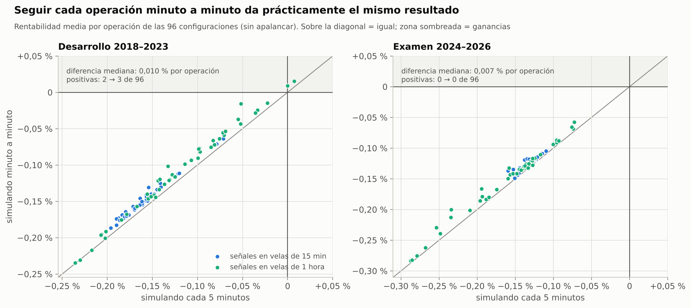
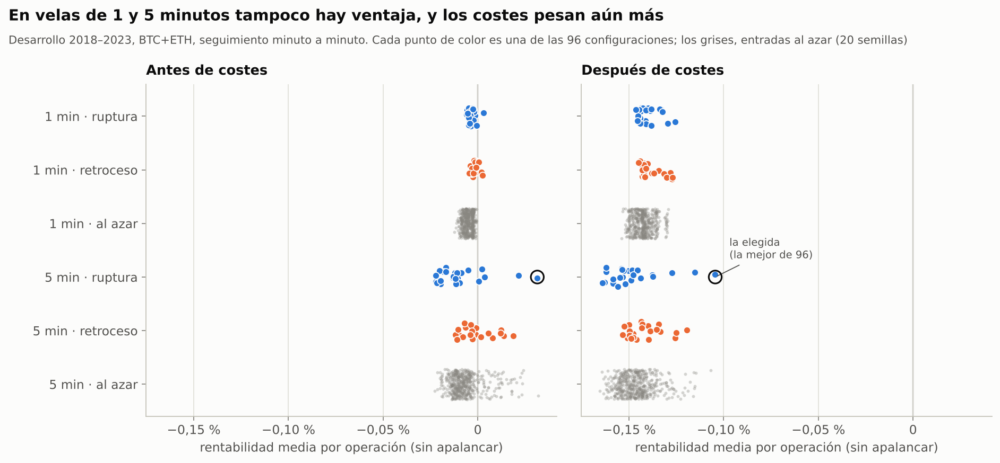
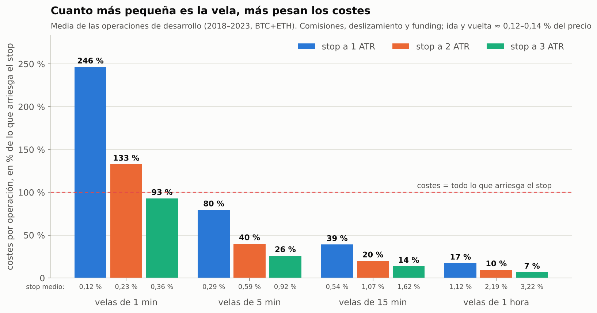

# Ampliación: la estrategia intradía con velas de 1 minuto

*Estado: **pre-registrado** el 22 de octubre de 2026, antes de simular ninguna operación con velas de 1 minuto. Los resultados se añadirán debajo sin modificar esta sección.*

Continúa [`intradia_10x.md`](intradia_10x.md): misma estrategia (stop según volatilidad → breakeven → objetivo o stop que persigue), mismos costes y mismos criterios.

## Pregunta

¿Cambia la conclusión al usar velas de 1 minuto? Hay dos lecturas posibles y se prueban las dos:

- **A) Precisión.** Se repiten las 96 configuraciones ya probadas (señales en velas de 15 minutos y de 1 hora), pero siguiendo cada operación minuto a minuto en lugar de cada 5 minutos.
- **B) Operar en 1 minuto.** Se generan señales en velas de 1 y de 5 minutos y cada operación se sigue minuto a minuto.

## Dato previo (descriptivo, sin simular operaciones)

Distancia mediana del stop en desarrollo (BTC y ETH, junio 2018 – diciembre 2023), frente a unos costes de ida y vuelta del 0,14 %:

| Velas | Stop a 1 ATR | Stop a 3 ATR | Costes en % del riesgo (1 ATR) | Costes en % del riesgo (3 ATR) |
|---|---|---|---|---|
| 1 min | 0,10 % | 0,29 % | 147 % | 49 % |
| 5 min | 0,24 % | 0,72 % | 60 % | 20 % |
| 15 min | 0,44 % | 1,32 % | 32 % | 11 % |
| 1 hora | 0,93 % | 2,80 % | 15 % | 5 % |

**El breakeven "entrada + costes" a menudo no se puede colocar.** Si el precio de activación (0,5R, 1R o 2R) está más cerca de la entrada que los costes (0,14 %), un stop en "entrada + costes" quedaría por encima del precio. Pasa en estos casos (% de las velas):

| Velas | 1 ATR · 0,5R | 1 ATR · 1R | 1 ATR · 2R | 3 ATR · 0,5R |
|---|---|---|---|---|
| 1 min | 94 % | 71 % | 32 % | 48 % |
| 5 min | 61 % | 21 % | 4 % | 9 % |
| 15 min | 24 % | 4 % | 0,6 % | 1 % |
| 1 hora | 3 % | 0,3 % | 0 % | 0 % |

Con la regla tal como está escrita en el protocolo original, en esos casos la operación se cierra en la apertura de la vela siguiente: el stop ya está "pasado". Se mantiene la regla sin cambios y se informará de cuántas operaciones terminan así.

## Diseño (congelado)

Todo igual que en el protocolo original, salvo lo que se indica:

- **Velas de gestión:** 1 minuto, spot de Binance (BTCUSDT y ETHUSDT), del 1 de marzo de 2018 al 21 de octubre de 2026.
- **Parte A:** las mismas 96 configuraciones (señales en 15 minutos y 1 hora) y las mismas reglas de selección y criterios. No se repiten las entradas al azar, porque el objetivo es comparar con la simulación cada 5 minutos; el criterio 2 queda sin evaluar.
  - **Lectura:** si con velas de 1 minuto ninguna configuración pasa a cumplir los criterios 1, 3 y 4, la conclusión original no depende de la resolución de la simulación.
- **Parte B:** señales en velas de **1 y 5 minutos**, con todo lo demás como en el protocolo original:
  - mismas entradas (ruptura de 20 velas y retroceso a la media de 20 ± 1 ATR de 14 velas);
  - mismo filtro de tendencia diario;
  - misma gestión: stop a 1, 2 o 3 ATR; breakeven a 0,5R, 1R, 2R o sin breakeven; objetivo 3R o stop que persigue; cierre a las 24 horas;
  - mismos costes, las mismas entradas al azar como control (20 semillas, con la frecuencia de la ruptura), la misma regla de selección (≥ 150 operaciones) y los mismos 5 criterios.
- **Periodos:** desarrollo del 1-6-2018 al 31-12-2023 y examen del 1-1-2024 al 21-10-2026, que se ejecuta una sola vez.

**Lo que se espera (escrito antes de ejecutar).**
- **Parte A:** resultados prácticamente iguales a los de la simulación cada 5 minutos. Las velas ambiguas eran muy raras.
- **Parte B:** pérdidas mayores. En velas de 1 minuto los costes superan al riesgo de cada operación. Para salir positiva, una entrada necesitaría ganar antes de costes del orden del 0,15–0,3 % por operación, unas 10–20 veces más que la mejor configuración de 15 minutos y 1 hora.

**Transparencia.**
- El periodo de examen ya se usó en el análisis original (con 15 minutos y 1 hora); las señales de 1 y 5 minutos no se han simulado nunca.
- Un operador de 1 minuto podría entrar con órdenes límite para pagar menos comisión. Simularlo bien exige modelar qué órdenes se llenan y cuáles no, y no se hace aquí. Como referencia, se informará de la rentabilidad **antes de costes**: si no es claramente positiva, ninguna estructura de comisiones puede salvar la estrategia.

---

## Resultados

*22 de octubre de 2026 · Ejecutado una sola vez, tal como está escrito arriba.*

### En resumen

- **A) Seguir cada operación minuto a minuto no cambia nada.** Las 96 configuraciones dan prácticamente lo mismo: la diferencia mediana es del 0,01 % por operación. La regla elige la misma configuración y en el examen siguen perdiendo las 96.
- **B) Operar con señales de 1 o 5 minutos es peor.**
  - Las 96 configuraciones pierden después de costes, entre −0,10 % y −0,16 % por operación, y todas con claridad estadística (t ≤ −5,7).
  - Antes de costes no ganan nada: −0,004 % de media.
  - Los costes pesan más que el propio riesgo: en velas de 1 minuto con stop a 1 ATR, se paga en costes 2,5 veces lo que arriesga el stop.
- **Ningún apalancamiento cumple tu límite con señales de 1 o 5 minutos, ni siquiera 0,5x.** La mejor configuración pierde a 1x el 90 % de la cuenta en tres años; a 10x, la mitad en 3 días.
- **El breakeven ni siquiera se puede colocar** en la mayoría de operaciones de 1 minuto. El "entrada + costes" queda por encima del precio al que se activa.

**Conclusión: la estrategia queda descartada también en 1 minuto.** Cuanto más pequeña es la vela, peor, porque los costes son fijos y el stop se acerca.

### A) Precisión: la misma rejilla seguida minuto a minuto



| | Siguiendo cada 5 min | Siguiendo minuto a minuto |
|---|---|---|
| Configuraciones positivas en desarrollo | 2 de 96 | 3 de 96 (ninguna con t ≥ 2) |
| Configuraciones positivas en el examen | 0 de 96 | 0 de 96 |
| Configuración elegida por la regla | 1 h · ruptura · stop 3 ATR · sin breakeven · objetivo 3R | la misma |
| Elegida, desarrollo | +0,007 % por operación (t = 0,08) | +0,016 % (t = 0,16) |
| Elegida, examen | −0,29 % (t = −3,0) | −0,28 % (t = −3,0) |
| Mayor apalancamiento que cumple tu límite | 0,5x | 0,5x |

- **Diferencia por configuración:** 0,010 % por operación de mediana en desarrollo y 0,007 % en el examen; la mayor, 0,036 %.
- **Minuto a minuto sale algo mejor**, porque el breakeven y el stop que persigue se ajustan antes. Pero la mejora es diez veces menor que los costes.
- **Criterios:** suspende el 1, el 3, el 4 y el 5. El 2 no se evalúa en esta parte.

### B) Señales en velas de 1 y 5 minutos

| Criterio | Resultado | ¿Aprueba? |
|---|---|---|
| 1. Desarrollo: media neta > 0 con t ≥ 2 | −0,104 % por operación, t = −5,7 (10.227 operaciones) | No |
| 2. Mejor que el percentil 95 del azar | −0,104 % frente a −0,114 %: pierde menos que el azar, pero pierde | Sí |
| 3. Al menos la mitad de vecinas positivas | 0 de 7 | No |
| 4. Examen: media neta > 0 | −0,102 % por operación, t = −5,5 (5.286 operaciones) | No |
| 5. Riesgo a 10x | Se pierde el 100 % en desarrollo y en el examen | No |

**La regla eligió 5 minutos · ruptura · stop a 3 ATR · sin breakeven · objetivo 3R.**
- Hace 1.831 operaciones al año, gana el 28 % y cada operación dura 5,7 horas de media.
- El stop medio está al 0,89 %. El 71 % termina en el stop, el 24 % en el objetivo y el 5 % por tiempo.
- Antes de costes gana +0,03 % por operación, pero los costes son de ~0,14 %.



- **Antes de costes no hay nada:**
  - las 96 configuraciones ganan de media −0,004 % por operación y solo 18 son positivas (la mejor, +0,03 %);
  - las entradas al azar con el filtro de tendencia, −0,005 % (1 min) y −0,007 % (5 min);
  - la pequeña ventaja que el filtro de tendencia daba en velas de 1 hora (+0,07 %) desaparece.
- **Frente al azar:** 52 de las 96 superan al percentil 95 de las entradas al azar. Los retrocesos de 1 minuto lo hacen mejor que el 97 % del azar. Pero la diferencia es de milésimas por operación, frente a unos costes de 0,13–0,14 %: es estadística, no dinero.
- **Volumen de operaciones:** en velas de 1 minuto se hacen de media entre 17.000 y 59.000 operaciones al año (según el stop), y hasta 110.000 en el caso extremo. En velas de 5 minutos, entre 3.000 y 11.000.



**Con apalancamiento** (configuración elegida, BTC y ETH al 50 %, reparto mensual):

| Apalancamiento | Desarrollo 2018–23: rentab. anual | Peor caída | Examen 2024–26: rentab. anual | Peor caída | Prob. de caer > 50 % en 1 año |
|---|---|---|---|---|---|
| 0,5x | −40 % | −95 % | −39 % | −76 % | 25 % |
| 1x | −66 % | −99,8 % | −64 % | −95 % | 96 % |
| 2x | −91 % | −100 % | −89 % | −99,8 % | 100 % |
| 3x | −98 % | −100 % | −97 % | −100 % | 100 % |
| 10x | −100 % | −100 % | −100 % | −100 % | 100 % |

- **A 10x:** −50 % el 3 de junio de 2018 (al tercer día), −90 % a finales de agosto de 2018 y −99 % en diciembre de 2018.
- **A 1x:** −50 % en octubre de 2019, −90 % en junio de 2021 y −99 % en noviembre de 2022.
- **Ni con riesgo fijo:** arriesgando solo el 0,5 % de la cuenta por operación pierde un 62 % al año en desarrollo y un 69 % en el examen.

**El breakeven:**
- **Mejora la rentabilidad en pocas combinaciones:** 8 de 24 a 0,5R, 9 de 24 a 1R y 6 de 24 a 2R. El efecto medio es de −0,002 % a −0,007 % por operación.
- **En la configuración elegida:** con breakeven a 0,5R, el 59 % de las operaciones termina en breakeven y la media empeora de −0,10 % a −0,15 %.
- **Cuántas veces no se puede colocar** el breakeven "entrada + costes" (desarrollo):

| Velas · stop · breakeven | Operaciones con breakeven no colocable | Operaciones cerradas por ese motivo |
|---|---|---|
| 1 min · 1 ATR · 0,5R | 94 % | 55 % |
| 1 min · 3 ATR · 0,5R | 54 % | 34 % |
| 1 min · 1 ATR · 2R | 36 % | 11 % |
| 5 min · 1 ATR · 0,5R | 61 % | 38 % |
| 5 min · 3 ATR · 0,5R | 11 % | 7 % |
| 15 min · 1 ATR · 0,5R (análisis original) | 22 % | 14 % |
| 1 hora · cualquier stop | ≤ 1,8 % | ≤ 1,1 % |

En el análisis original esto afectó sobre todo a "15 min · stop 1 ATR · breakeven 0,5R", que perdía de todos modos. La configuración elegida entonces no usaba breakeven, así que la conclusión no cambia.

**Otros cortes de la configuración elegida:**
- Pierden los largos y los cortos, BTC y ETH, en desarrollo y en el examen (t entre −2,6 y −5,9).
- Por años, solo 2018 fue positivo a 1x (+15 %); los demás años pierden entre un 45 % y un 82 %.

### Corrección al pre-registro

En la expectativa escribí que, en velas de 1 minuto, una entrada necesitaría ganar antes de costes un 0,15–0,3 % por operación, "unas 10–20 veces más que la mejor configuración de 15 minutos y 1 hora".
- **La comparación no era correcta.** La mejor de 1 hora ganaba +0,18 % antes de costes, así que harían falta entre 1 y 2 veces eso.
- **Las "10–20 veces" valen frente a la media** de las 96 configuraciones de 15 minutos y 1 hora (+0,01 %).
- **No afecta a ningún criterio ni al resultado:** con velas de 1 y 5 minutos, ninguna configuración pasa de +0,03 % antes de costes.

### Limitaciones

- **Comisiones de nivel básico y órdenes a mercado.** Con órdenes límite, un operador de 1 minuto pagaría menos, pero no todas sus órdenes se ejecutarían, y las que sí tienden a ser las peores. Como antes de costes no hay ventaja, esto no cambiaría la conclusión.
- **Velas de spot** como aproximación a los perpetuos, igual que en el análisis original.
- **Cierre por tiempo a las 24 horas**, igual que en el original. En 1 minuto casi nunca llega a usarse.

### Reproducir

```bash
python scripts/download_data.py                  # incluye las velas de 1 minuto de BTC y ETH (~360 MB)
python scripts/intraday_analysis.py --velas 1m --temporalidades 15m,1h --sin-azar --procesos 4 \
       --salida results/intradia_gestion_1min    # parte A (~1 minuto)
python scripts/intraday_analysis.py --velas 1m --temporalidades 1m,5m --procesos 4 \
       --salida results/intradia_1min            # parte B (~9 minutos)
python scripts/breakeven_check.py --velas 1m --temporalidades 1m,5m --salida results/intradia_1min
python scripts/charts_intraday_1min.py           # gráficos 18-20
```
