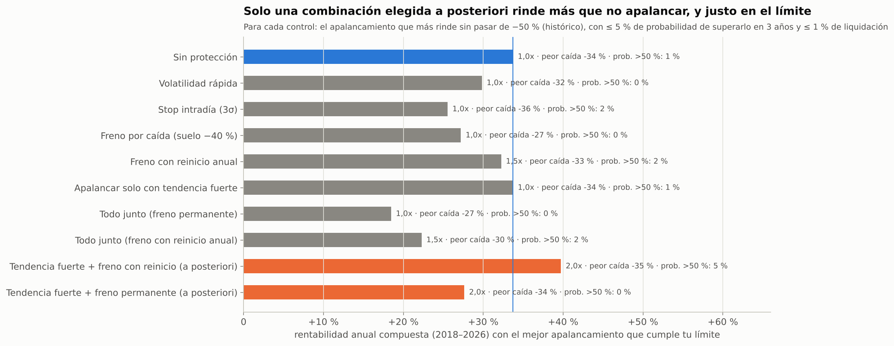
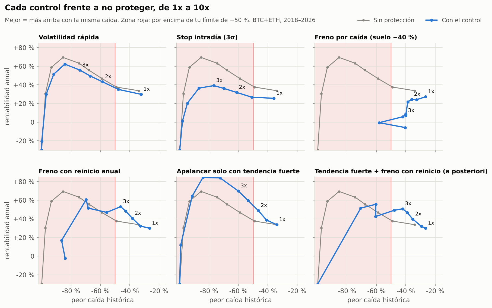

# Controles de protección y apalancamiento (solo BTC y ETH)

*22 de octubre de 2026 · Estrategia A sobre BTC y ETH (50/50, reparto mensual) · Datos de Binance de marzo 2018 a octubre 2026.*

## Pregunta

¿Podemos añadir controles que protejan ante caídas y, gracias a ellos, usar más apalancamiento sin romper tu límite de −50 %?

## Resumen

**Respuesta corta: los controles reducen las caídas, pero en esta estrategia casi no permiten ganar más apalancando.**

- **No apalancar (1x) sigue siendo lo mejor entre lo fijado de antemano:** 34 % al año (2018–2026), peor caída −34 % y ~1 % de probabilidad de superar el −50 % en 3 años. Ningún control definido de antemano rinde más cumpliendo la regla.
- **Stop intradía:** elimina las liquidaciones incluso a 10x, pero salta en mechas que luego se recuperan (93 veces en 8 años). A 1x baja la rentabilidad del 34 % al 26 % sin reducir la caída.
- **Freno por caída permanente:** contiene la caída en ~−40 % aunque se apalanque mucho, pero cuanto más apalancas menos ganas. A 3x toca el suelo y se queda en USDT 6,6 años: 7 % al año.
- **Los dos controles que mejoran la curva** son el freno con reinicio anual y apalancar solo con tendencia fuerte. Por sí solos se quedan en 1x–1,5x, porque la simulación da demasiada probabilidad de superar el −50 %.
- **La combinación de esos dos a 2x** es la única que rinde más que 1x cumpliendo la regla:
  - 40 % al año, caída −35 %, +29 % en 2025–2026.
  - Pero queda **justo en el límite de riesgo** (5,0 % de probabilidad de superar el −50 %, frente al ~1 % de 1x).
  - Y se eligió **después** de ver los resultados, así que es optimista.

**Recomendación:** arrancar el bot a **1x**. La combinación "tendencia fuerte + freno con reinicio a 2x" puede correr **en paralelo en el modo demo** como candidata. Solo pasaría a dinero real si en demo se comporta como en el backtest.

## Los controles probados

Todos se calculan con información hasta el cierre anterior, sin mirar al futuro. Los parámetros se han fijado por criterio y **no** optimizando sobre los datos.

| Control | Qué hace | Parámetro elegido | Por qué ese valor |
|---|---|---|---|
| **Volatilidad rápida** | Reduce la posición en cuanto el mercado se pone nervioso. Usa la mayor entre la volatilidad de 30 días y una rápida de ~10 días | media exponencial con vida media de 5 días | estándar en control de riesgo |
| **Stop intradía** | Si el precio cae más de 3 movimientos diarios normales desde el cierre anterior, cierra la posición. Vuelve a entrar al día siguiente si la señal sigue | 3 desviaciones típicas; nunca más lejos de la mitad de la distancia a la liquidación | 3σ solo salta en días anómalos; la mitad de la distancia evita liquidaciones |
| **Freno por caída** (CPPI/TIPP) | Cuanto más cae la cuenta desde su máximo, menos apalanca: todo el apalancamiento en máximos, cero al llegar al suelo | suelo a −40 % del máximo | 10 puntos de margen sobre tu −50 % para absorber huecos |
| **Freno con reinicio anual** | Igual, pero el máximo de referencia es el de los últimos 365 días. Tras tocar el suelo puede volver a operar | 365 días | evita quedarse en USDT para siempre |
| **Solo con tendencia fuerte** | Apalanca por encima de 1x solo si las tres medias (50, 100 y 200 días) están a favor | — | apalancar solo cuando la señal es más fiable |
| **Todo junto** | Los cuatro anteriores a la vez | — | — |

**Regla de aceptación (fijada antes de ver resultados).** Un apalancamiento es aceptable si cumple las tres condiciones:
1. La peor caída histórica (2018–2026) no supera el −50 %.
2. En la simulación de 3 años (400 escenarios), la probabilidad de caer más de un 50 % es ≤ 5 %.
3. La probabilidad de alguna liquidación es ≤ 1 %.

## Resultados



**El mejor apalancamiento aceptable de cada control** (el que más rinde cumpliendo la regla):

| Control | Apalancamiento | Rentab. anual 2018–26 | Peor caída | Examen 2025–26 | Prob. caída > 50 % en 3 años |
|---|---|---|---|---|---|
| **Sin protección** | **1x** | **34 %** | **−34 %** | **+26 %** | **1 %** |
| Volatilidad rápida | 1x | 30 % | −32 % | +20 % | 0 % |
| Stop intradía | 1x | 26 % | −36 % | +20 % | 2 % |
| Freno por caída (permanente) | 1x | 27 % | −27 % | +18 % | 0 % |
| Freno con reinicio anual | 1,5x | 32 % | −33 % | +20 % | 2,5 % |
| Solo con tendencia fuerte | 1x | 34 % | −34 % | +26 % | 1 % |
| Todo junto (permanente) | 1x | 18 % | −27 % | +13 % | 0 % |
| Todo junto (reinicio anual) | 1,5x | 22 % | −30 % | +17 % | 2 % |
| *Tendencia fuerte + freno con reinicio (a posteriori)* | *2x* | *40 %* | *−35 %* | *+29 %* | *5,0 %* |
| *Tendencia fuerte + freno permanente (a posteriori)* | *2x* | *28 %* | *−34 %* | *+22 %* | *0 %* |

Con el freno permanente, la regla admitiría hasta 6x, pero a ese nivel la rentabilidad es del 6 % al año porque la cuenta se queda en USDT. Por eso la tabla muestra el apalancamiento que **más rinde**, no el máximo.

**Configuraciones tentadoras que la simulación rechaza.** En el histórico real cumplen tu límite y rinden más, pero la probabilidad de superar el −50 % en 3 años es demasiado alta:

| Configuración | Rentab. anual | Peor caída histórica | Examen 2025–26 | Prob. caída > 50 % |
|---|---|---|---|---|
| Sin protección 1,5x | 38 % | −49 % | +33 % | 22 % |
| Freno con reinicio anual 2x | 41 % | −38 % | +22 % | 9 % |
| Freno con reinicio anual 3x | 53 % | −46 % | +26 % | 30 % |
| Solo con tendencia fuerte 1,5x | 39 % | −41 % | +34 % | 14 % |
| Solo con tendencia fuerte 2x | 49 % | −46 % | +42 % | 36 % |
| Tendencia fuerte + freno con reinicio 2,5x | 47 % | −39 % | +34 % | 12 % |

La diferencia entre el histórico y la simulación tiene explicación:
- **El histórico es un único camino.** Entre 2018 y 2026 los meses malos quedaron repartidos.
- **La simulación recombina bloques de 30 días.** Construye caminos plausibles en los que varios meses malos caen seguidos.

Si aceptaras, por ejemplo, un 10 % de probabilidad de superar el −50 %, el freno con reinicio anual a 2x entraría.



### Por qué aquí los controles no permiten apalancar mucho más

1. **Las caídas de A no vienen de desplomes repentinos**, sino de rachas de señales falsas, como el mercado lateral de 2022–2023. Un stop no protege de eso.
2. **En tendencia alcista, las caídas intradía suelen rebotar** (lo vimos al estudiar la estrategia B). El stop vende justo en el peor momento.
3. **El freno vende después de perder y vuelve a subir la exposición tarde**, así que se pierde parte de la recuperación. En su versión permanente puede dejar la cuenta en USDT para siempre.
4. **Apalancar cuesta.** El funding se paga sobre todo el nocional (de media ~12 % al año en BTC desde 2020) y mantener el apalancamiento obliga a reajustar con comisiones.

### Sensibilidad

He variado los parámetros de "todo junto" (stop a 2, 3 o 4 desviaciones; suelo a −30 % o −40 %; volatilidad objetivo del 30, 40 o 60 %) con 2x, 3x y 5x, en total 54 combinaciones. Todas rinden entre −4 % y 22 % al año, **ninguna llega al 34 % de no apalancar**. La conclusión no depende de los parámetros elegidos.

### Limitaciones

- **No hay datos nuevos:** 2025–2026 ya se había usado. Los parámetros se fijaron por criterio, y las dos combinaciones "a posteriori" están marcadas porque se eligieron viendo los resultados.
- **La simulación es una prueba de estrés, no una predicción.** Al recombinar bloques de 30 días rompe las tendencias largas.
- **El stop se modela con deslizamiento extra,** pero en un desplome real (o con el exchange saturado) podría ser peor.
- **Liquidación:** se ha usado un margen de mantenimiento del 0,5 %; los niveles reales de OKX pueden diferir según el tamaño de la posición.

## Reproducir

```bash
python scripts/protection_analysis.py   # ~20 minutos (400 escenarios por combinación)
python scripts/charts_protection.py     # gráficos 12 y 13
```

Resultados en `results/proteccion/`.

## Cómo se aplicarían en el bot

- **Stop:** como orden condicional en el propio exchange (OKX), no ejecutado por el bot. Así protege aunque el servidor del bot se caiga. En el backtest se asume un deslizamiento extra en días de desplome: como mínimo 0,5 %, más un 10 % de lo que el precio atraviese el stop.
- **Freno por caída:** se calcula una vez al día con el saldo total de la cuenta. Si se toca el suelo, el bot pasa todo a USDT y avisa.
- **Parada de emergencia manual:** independiente de todo lo anterior, siempre disponible.
