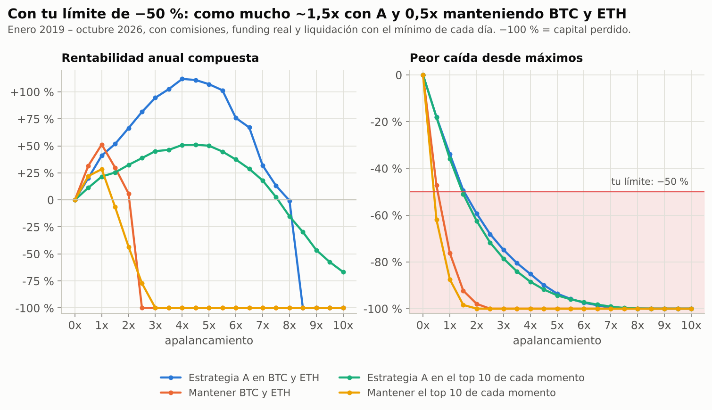
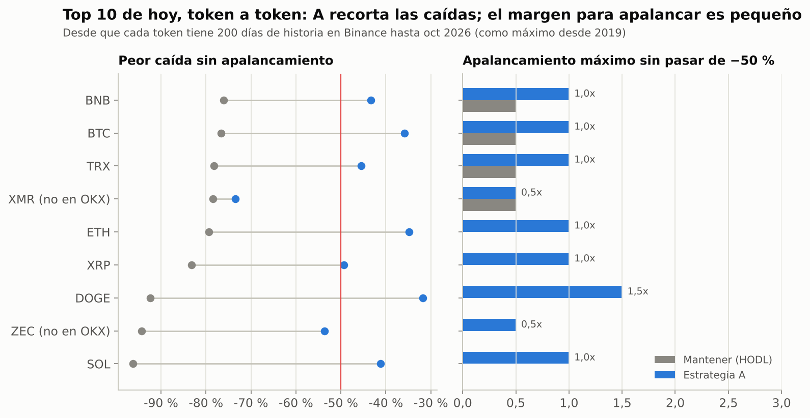
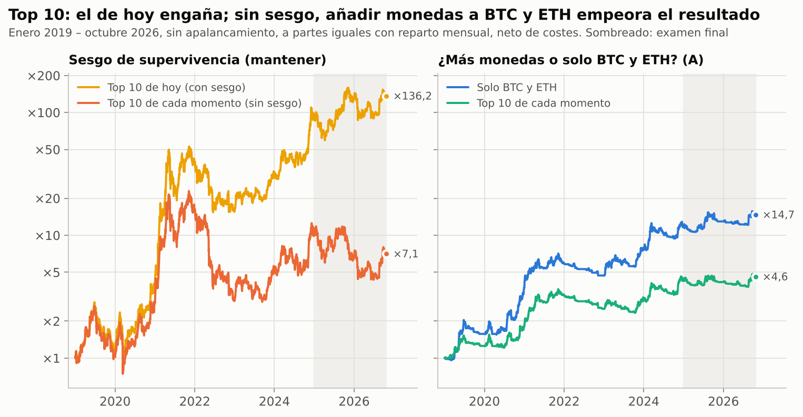

# Ampliación: top 10 y apalancamiento de 0x a 10x

*22 de octubre de 2026 · Datos de Binance hasta el 21-10-2026 · Todo reproducible (ver final).*

## Resumen

**Apalancamiento**
- **Estrategia A (BTC y ETH):** sin pasar de tu límite de −50 %, el máximo histórico es ~1,5x (caída −49 %). En simulación, 1,5x supera el −50 % en 1 de cada 4 escenarios de 3 años; 1x, solo en el 3 %. **Recomendación: sin apalancamiento (1x).**
- **En el examen 2025–2026 apalancar no compensó.** 1x dio +26 %, 2x +27 % y 3x +29 %, pero la caída máxima pasó de −21 % a −41 % y −57 %. Con 10x la cuenta se liquidó.
- **Mantener (HODL) apalancado lleva a la ruina.** Con BTC y ETH ni siquiera 1x cumple tu límite (caída −76 %). A 2,5–3x se liquida.
- **Las estrategias descartadas empeoran al apalancarlas.** La rotación original se liquida desde 3x, y B pierde más cuanto más se apalanca en 2025–2026.

**Top 10**
- **El top 10 de hoy engaña.** Mantenerlo desde 2019 daría ×136, pero son los ganadores elegidos a posteriori. Con el **top 10 de cada momento** (sin ese sesgo), mantener da ×7 con caídas del −88 %.
- **Ampliar de BTC y ETH al top 10 empeora el resultado.** Con A, solo BTC y ETH da ×14,7 (41 % al año, caída −34 %); el top 10 de cada momento, ×4,6 (22 % al año, −36 %). Los altcoins del top 10 rindieron mucho menos que BTC y ETH.
- **2 de las 10 monedas de hoy (Zcash y Monero) no se pueden operar en OKX**, que las deslistó en 2024. Otra (Hyperliquid) solo cotiza en Binance desde septiembre de 2026.

**Conclusión: el bot debería operar la estrategia A solo en BTC y ETH, y sin apalancamiento.**

---

## 1. Cómo se ha simulado el apalancamiento

- **0x** = todo en USDT. **0,5x** = la mitad invertida. **1x** = como hasta ahora, en spot. **Más de 1x** = futuros perpetuos.
- **Costes:** spot 0,15 % por unidad operada; futuros 0,05 % de comisión + 0,05 % de deslizamiento.
- **Funding real** de Binance sobre todo el nocional (antes de 2020, 0,01 % cada 8 h). Los largos pagan cuando el funding es positivo, que es lo habitual en mercados alcistas: en BTC ha sido de media un 12 % al año desde 2020.
- **Liquidación con el mínimo de cada día, no solo con el cierre.** Si el mínimo del día deja el capital de una posición por debajo del margen de mantenimiento (0,5 %), esa posición se pierde entera.
- **Mantener el apalancamiento cuesta.** El bot reajusta la posición cuando se desvía más de un 10 % del objetivo, pagando comisión. Con apalancamiento eso obliga a vender en las caídas y comprar en las subidas.
- **Cartera:** a partes iguales y re-repartida cada mes. Una posición liquidada vuelve a recibir capital el mes siguiente.
- Por el reparto mensual, las cifras a 1x difieren un poco de la validación anterior. Por ejemplo, el examen 2025–2026 da +25,7 % frente a +25,5 %.

## 2. BTC y ETH con apalancamiento



**Enero 2019 – octubre 2026:**

| Apalancamiento | A: multiplicador | A: rentab. anual | A: peor caída | HODL: multiplicador | HODL: rentab. anual | HODL: peor caída |
|---|---|---|---|---|---|---|
| 0x | ×1,0 | 0 % | 0 % | ×1,0 | 0 % | 0 % |
| 0,5x | ×4,2 | 20 % | −18 % | ×8,5 | 32 % | −47 % |
| **1x** | **×14,7** | **41 %** | **−34 %** | ×25,3 | 51 % | −76 % |
| 1,5x | ×26,0 | 52 % | −49 % | ×7,7 | 30 % | −92 % |
| 2x | ×53,5 | 66 % | −59 % | ×1,6 | 6 % | −98 % |
| 3x | ×181 | 95 % | −75 % | liquidada | −100 % | −100 % |
| 5x | ×295 | 107 % | −94 % | liquidada | −100 % | −100 % |
| 10x | liquidada | −100 % | −100 % | liquidada | −100 % | −100 % |

**Examen final (enero 2025 – octubre 2026)**, los datos más recientes:

| Apalancamiento | A: resultado | A: peor caída | HODL: resultado | HODL: peor caída |
|---|---|---|---|---|
| 0,5x | +13 % | −11 % | −2 % | −35 % |
| **1x** | **+26 %** | **−21 %** | −15 % | −60 % |
| 1,5x | +26 % | −32 % | −52 % | −80 % |
| 2x | +27 % | −41 % | −71 % | −90 % |
| 3x | +29 % | −57 % | −93 % | −98 % |
| 5x | +6 % | −78 % | −100 % | −100 % |
| 10x | liquidada | −100 % | liquidada | −100 % |

**Simulación de 3 años** (400 escenarios con bloques de 30 días de 2018–2026):

| Apalancamiento | A: prob. caída > 50 % | A: prob. liquidación | A: prob. perder > 90 % | HODL: prob. caída > 50 % | HODL: prob. perder > 90 % |
|---|---|---|---|---|---|
| 0,5x | 0 % | 0 % | 0 % | 20 % | 0 % |
| **1x** | **3 %** | 0 % | 0 % | 91 % | 0,5 % |
| 1,5x | 23 % | 0 % | 0 % | 100 % | 12 % |
| 2x | 51 % | 0 % | 0 % | 100 % | 24 % |
| 3x | 92 % | 0,2 % | 0,5 % | 100 % | 65 % |
| 5x | 100 % | 2 % | 6 % | 100 % | 99 % |
| 10x | 100 % | 99,5 % | 95 % | 100 % | 100 % |

**Por qué el apalancamiento alto destruye valor:**
1. **Volatilidad:** con rentabilidades que suben y bajan, apalancar multiplica las pérdidas más de lo que multiplica las ganancias. Perder un 50 % exige ganar un 100 % para recuperarse.
2. **Funding:** apalancado en futuros pagas financiación sobre todo el nocional. En 2021, por ejemplo, fue del ~30 % anual en BTC.
3. **Liquidación:** a 10x basta una mecha intradía del −10 %, y en cripto eso pasa varias veces al año.
4. **Las caídas crecen casi en proporción:** 1x −34 %, 2x −59 %, 3x −75 %.

En 2019–2026 la máxima rentabilidad de A se habría logrado con ~4x (+112 % al año), pero con caídas del −85 % y gracias a un periodo excepcionalmente alcista. En 2025–2026, un mercado más difícil, apalancar no aportó y solo añadió riesgo.

## 3. El top 10 de hoy (con sesgo)

Las 10 mayores por capitalización según CoinGecko (22-10-2026), sin stablecoins ni activos tokenizados: **BTC, ETH, BNB, XRP, SOL, TRX, ZEC, HYPE, DOGE y XMR**.

- **HYPE** solo cotiza en Binance desde septiembre de 2026: no hay historia suficiente para la estrategia.
- **ZEC y XMR** son monedas de privacidad que **OKX deslistó en enero de 2024**, así que no podrías operarlas. XMR además salió de Binance en febrero de 2024.



Resultados sin apalancamiento, desde 2019 (o desde que cada token tiene 200 días de historia) hasta octubre de 2026:

| Token | En OKX | A: rentab. anual | A: peor caída | A: Sharpe | HODL: rentab. anual | HODL: peor caída | HODL: Sharpe | Apalancamiento máx. sin pasar de −50 % (A / HODL) |
|---|---|---|---|---|---|---|---|---|
| BTC | sí | 41 % | −36 % | 1,31 | 49 % | −77 % | 0,96 | 1x / 0,5x |
| ETH | sí | 38 % | −35 % | 1,19 | 45 % | −79 % | 0,87 | 1x / ninguno |
| BNB | sí | 40 % | −43 % | 1,18 | 85 % | −76 % | 1,15 | 1x / 0,5x |
| XRP | sí | 13 % | −49 % | 0,54 | 19 % | −83 % | 0,64 | 1x / ninguno |
| SOL (desde 2021) | sí | 34 % | −41 % | 1,12 | 45 % | −96 % | 0,88 | 1x / ninguno |
| TRX | sí | 28 % | −45 % | 0,82 | 44 % | −78 % | 0,83 | 1x / 0,5x |
| ZEC | **no** | 21 % | −54 % | 0,76 | 66 % | −94 % | 1,01 | 0,5x / ninguno |
| DOGE (desde 2020) | sí | 40 % | −32 % | 1,04 | 69 % | −92 % | 0,79 | 1,5x / ninguno |
| XMR (hasta feb 2024) | **no** | −5 % | −73 % | 0,02 | 19 % | −78 % | 0,66 | 0,5x / 0,5x |
| HYPE | sí | — | — | — | — | — | — | sin historia suficiente |

- A **reduce la caída en las 9**. Sin apalancamiento cumple tu límite en 7 de 9; las excepciones son ZEC (−54 %) y XMR (−73 %).
- Las rentabilidades de mantener son muy altas porque **son los supervivientes**, elegidos sabiendo que hoy están arriba.
- **El caso XMR** es una advertencia útil. La estrategia perdió poco a poco en el mercado lateral de 2021–2023 y luego sufrió el desplome por el deslistado (−36 % en un día, febrero de 2024). Una señal de tendencia no puede esquivar un golpe regulatorio repentino.

## 4. El top 10 de cada momento (sin sesgo)

No existe histórico gratuito de capitalización, así que el top 10 de cada momento se define por **liquidez**:
- Cada mes, los 10 tokens con más volumen en Binance (contra USDT) en los 90 días anteriores.
- Sin stablecoins, monedas fiat ni tokens apalancados, y exigiendo 200 días de historia.
- **Incluye los que luego se hundieron o se deslistaron:** LUNA (antes del colapso), EOS, NEO, BTT, CHZ, MATIC, etc.
- Entre 2019 y 2026 han pasado por él **50 tokens distintos** (detalle mes a mes en `results/top10/pit_composicion_mensual.csv`).

Para un bot es además el universo relevante, porque lo que importa es poder operar con liquidez.



**Enero 2019 – octubre 2026:**

| Apalancamiento | A top 10: multiplicador | A top 10: peor caída | HODL top 10: multiplicador | HODL top 10: peor caída |
|---|---|---|---|---|
| 0,5x | ×2,3 | −18 % | ×4,7 | −62 % |
| **1x** | **×4,6** | **−36 %** | ×7,1 | −88 % |
| 1,5x | ×5,9 | −51 % | ×0,58 | −98 % |
| 2x | ×8,9 | −62 % | ×0,01 | −100 % |
| 3x | ×18,4 | −79 % | liquidada | −100 % |
| 5x | ×23,9 | −94 % | liquidada | −100 % |
| 10x | liquidada | −100 % | liquidada | −100 % |

En el examen 2025–2026: A top 10 a 1x, +7 % (caída −19 %); mantener el top 10, −31 % (caída −63 %).

**Comparación clave a 1x (2019–2026):**

| Universo | A: multiplicador | A: peor caída | A: Sharpe | HODL: multiplicador | HODL: peor caída |
|---|---|---|---|---|---|
| **Solo BTC y ETH** | **×14,7** | **−34 %** | **1,36** | ×25,3 | −76 % |
| Top 10 de cada momento (sin sesgo) | ×4,6 | −36 % | 1,00 | ×7,1 | −88 % |
| Top 10 de hoy (con sesgo) | ×10,5 | −31 % | 1,43 | ×136 | −71 % |

## 5. Estrategias descartadas con apalancamiento

| Apalancamiento | Rotación original (dev. 2018–2024) | Rotación original (examen) | B: comprar caídas (dev.) | B: comprar caídas (examen) |
|---|---|---|---|---|
| 1x | ×2,5 (caída −86 %) | ×0,30 | ×3,4 | ×0,97 |
| 2x | ×0,002 | ×0,03 | ×8,8 | ×0,93 |
| 3x | liquidada | ×0,002 | ×16,3 | ×0,88 |
| 5x | liquidada | liquidada | ×13,9 (1 liquidación) | ×0,76 |
| 10x | liquidada | liquidada | liquidada | liquidada |

La rotación original va siempre 100 % invertida (en BTC o en ETH) y opera casi a diario, así que apalancarla la destruye. B parecía mejorar con apalancamiento en desarrollo, pero en 2025–2026 perdió más cuanto más apalancada.

## 6. Conclusión y recomendación

1. **Estrategia A, solo BTC y ETH, sin apalancamiento (1x).** Es lo que mejor equilibra rentabilidad y tu límite de −50 %. En simulación, 3 % de probabilidad de una caída mayor del 50 % en 3 años.
2. **No ampliar a altcoins.** Sin el sesgo de supervivencia, añadir el resto del top 10 bajó el multiplicador final de ×14,7 a ×4,6 (de 41 % a 22 % anual), con la misma caída. Además, parte del top 10 no se puede operar en OKX y otras monedas pueden sufrir deslistados repentinos.
3. **No usar futuros para apalancar.** Si se usan, que sea solo para cubrir (por ejemplo, reducir exposición sin vender el spot).
4. **El siguiente paso no cambia:** construir el bot y probarlo en el modo demo de OKX.

## Reproducir

```bash
python scripts/download_universe.py      # velas diarias de los ~750 pares USDT de Binance (incluidos deslistados)
python scripts/leverage_analysis.py      # BTC/ETH, rotación y B con apalancamiento + simulación
python scripts/top10_analysis.py         # top 10 de hoy y de cada momento, con apalancamiento
python scripts/charts_top10_leverage.py  # gráficos 09-11
```

Resultados en `results/apalancamiento/` y `results/top10/`.

**Fuentes:** CoinGecko (clasificación por capitalización del 22-10-2026, guardada en `results/top10/coingecko_top30_2026-10-22.json`); Binance Public Data; deslistado de monedas de privacidad en OKX ([The Block](https://www.theblock.co/post/269613/ajames@theblock.co), [Cointelegraph](https://cointelegraph.com/news/okx-exchange-delist-privacy-tokens)).
