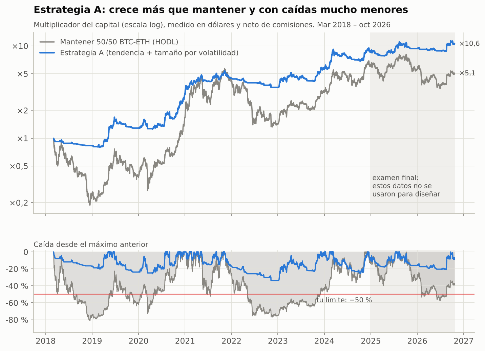
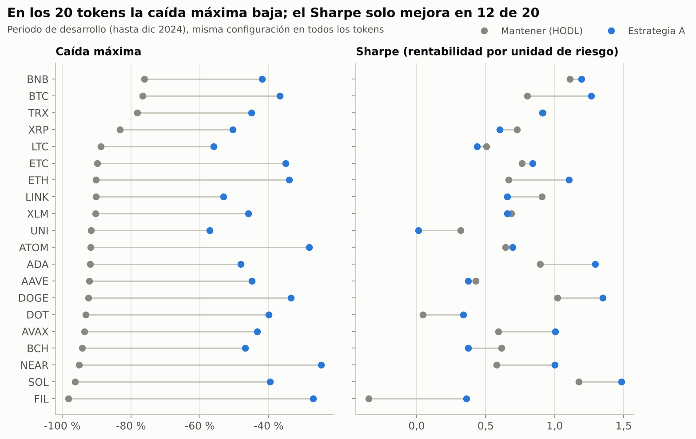

# Validación de la estrategia A + B

*Estado: **protocolo pre-registrado** (escrito y subido al repositorio antes de ejecutar ningún test). Los resultados se añadirán debajo sin modificar esta sección.*

## Objetivo del usuario (restricciones)

- Ganar en **euros/dólares** (no en BTC).
- Capital inicial ~5.000 €; **caída máxima tolerable: 50 %**.
- Exchange: OKX Europa (regulado en España bajo MiCA). Datos de Binance como referencia.
- Se permiten futuros.

## Hipótesis

- **A (núcleo):** estar comprado en BTC/ETH solo cuando hay tendencia alcista, y en USDT cuando no, mejora la rentabilidad ajustada por riesgo y reduce las caídas frente a mantener (HODL).
- **B (satélite):** dentro de una tendencia alcista, comprar tras una caída brusca de pocas horas y vender poco después da beneficio neto, porque tras caídas extremas hay un pequeño rebote.

## Configuración a priori (congelada, sin optimizar)

**A — Seguimiento de tendencia**
- Activos: BTC y ETH, 50 % del capital del núcleo en cada uno, sin reequilibrar entre ellos.
- Señal diaria (cierre UTC): conjunto de tres medias simples de **50, 100 y 200 días**. Exposición de tendencia = número de medias por debajo del precio ÷ 3 (0, ⅓, ⅔ o 1). Usar varias medias en vez de "la mejor" es la práctica habitual para no sobreajustar.
- Tamaño por volatilidad: escala = mín(1; **40 %** ÷ volatilidad anualizada de los últimos 30 días). Exposición = tendencia × escala (entre 0 y 1, sin apalancamiento).
- Solo se opera si la exposición objetivo cambia **≥ 10 puntos** (evita micro-operaciones).
- Instrumento: **spot** (los largos en futuros pagan funding). Efectivo en USDT al 0 % (conservador).
- Costes: 0,10 % de comisión (taker spot de OKX) + 0,05 % de deslizamiento = **0,15 % por unidad operada**.

**B — Comprar caídas bruscas con tendencia alcista**
- Activos: BTC y ETH, velas de 5 minutos.
- Filtro: solo si la exposición de tendencia de A al cierre diario anterior es **≥ ⅔**.
- Disparador: rentabilidad de las últimas **4 h** inferior a **−3 desviaciones típicas** (estimadas con los 30 días anteriores, sin mirar al futuro).
- Entrada al cierre de la vela del disparador; **salida a las 4 h**. Una operación abierta por activo como máximo.
- Instrumento: futuros perpetuos 1x. Costes: 0,02 % de entrada (orden límite) + 0,05 % de salida (a mercado) + 0,02 % de deslizamiento, más el **funding real** de las horas mantenidas.

## Periodos

- **Desarrollo:** desde que hay 200 días de historia (marzo de 2018) hasta el 31-12-2024.
- **Examen final:** 01-01-2025 a 21-10-2026. Se ejecuta **una sola vez**, al final, con todo congelado.
- **Transparencia:** la criba rápida previa ya miró 2018–2026 completo en BTC y ETH, así que el examen final no es 100 % virgen. Para compensarlo: (1) la configuración de A no se optimiza; (2) se prueba en **18 tokens que no se han mirado**; (3) B se valida también en otros 6 tokens.

## Criterios de aprobado (fijados antes de ver resultados)

Métricas en dólares con rentabilidades diarias: Sharpe anualizado (√365, tipo libre de riesgo 0), caída máxima y rentabilidad anual compuesta. Referencia: **HODL 50/50 BTC/ETH** (y HODL de cada activo).

**A aprueba si cumple todo:**
1. **Desarrollo:** en BTC, en ETH y en la cartera 50/50, Sharpe mayor que HODL y caída máxima ≤ 50 %.
2. **Robustez de parámetros:** en la rejilla (una sola media de 20 a 200 días × objetivo de volatilidad 30/40/60 %/sin), al menos el **70 %** de las combinaciones supera el Sharpe de HODL en desarrollo, en cada activo.
3. **Azar:** el *timing* de la tendencia supera al 95 % de las simulaciones con los mismos periodos dentro/fuera en orden aleatorio (BTC y ETH, desarrollo).
4. **Otros tokens:** con la misma configuración, mejora el Sharpe de HODL en **≥ ⅔** de los 18 tokens y reduce la caída máxima en **≥ 80 %**.
5. **Estrés:** con costes ×2 **y** un día de retraso en la ejecución, sigue cumpliendo el criterio 1 en la cartera 50/50.
6. **Examen final (cartera 50/50):** caída máxima ≤ 50 % y ≤ la de HODL; Sharpe ≥ el de HODL − 0,3 (margen por lo corto del periodo).

**B aprueba si cumple todo:**
1. **Desarrollo (BTC+ETH):** rentabilidad neta media por operación > 0 con t ≥ 2.
2. **Walk-forward 2020–2024** (parámetros elegidos cada año con los 2 anteriores): resultado neto positivo.
3. **El filtro de tendencia ayuda:** la rentabilidad neta por operación con filtro es mayor que sin filtro.
4. **Otros tokens:** neto positivo en al menos 4 de 6 (SOL, BNB, XRP, DOGE, ADA, LINK).
5. **Examen final:** neto positivo en 2025–2026.

**Decisión:** si A aprueba, se pasa a construir el bot (motor realista + paper trading en OKX). B solo se incluye si aprueba. Si no, el bot será solo A.

**Informativo (no decide):** walk-forward eligiendo la mejor media cada año; probabilidad de una caída > 50 % en 3 años por simulación (*bootstrap* por bloques); cartera combinada A+B.

---

## Resultados

*Ejecutados el 22-10-2026 con datos hasta el 21-10-2026. Los números salen de `results/validacion/`.*

### Veredicto

- **A (tendencia): aprueba 5 de 6 criterios, incluido el examen final con nota alta.** Suspende el criterio 4: en los 18 tokens no vistos, la caída máxima baja en los 18, pero el Sharpe solo mejora en 10 (se exigían 12).
- **B (comprar caídas): suspende** el walk-forward (criterio 2) y el examen final (criterio 5). **Queda descartada.**
- **Según el protocolo estricto, A tampoco aprueba**, porque falla un criterio. La propuesta de cómo seguir está al final de esta sección; la decisión es del usuario.

| Criterio | Resultado | Dato clave |
|---|---|---|
| A1 Desarrollo | ✅ | Cartera 50/50: Sharpe 1,26 frente a 0,73; caída máxima −34 % frente a −81 % |
| A2 Robustez de parámetros | ✅ | El 100 % de las 28 combinaciones supera a HODL, en BTC y en ETH |
| A3 Azar | ✅ | Mejor que el 97,9 % (BTC) y el 97,8 % (ETH) de las simulaciones |
| A4 Otros tokens | ❌ | Sharpe mejor en 10/18 (se pedían 12); caída menor en 18/18 |
| A5 Costes ×2 + 1 día de retraso | ✅ | Sharpe 1,14 frente a 0,73; caída −40 % |
| A6 Examen final 2025–2026 | ✅ | **+25,5 % frente a −18,0 %; caída −20,9 % frente a −60,0 %** |
| B1 Desarrollo | ✅ | +51,5 pb por operación, t = 3,76, 74 operaciones al año |
| B2 Walk-forward | ❌ | −4,0 % en 2020–2024 |
| B3 Filtro de tendencia | ✅ | +51,5 pb con filtro frente a +22,1 pb sin él |
| B4 Otros tokens | ✅ | Positivo en 6 de 6 |
| B5 Examen final | ❌ | −5,3 pb por operación (t = −0,34), −5,2 % en total |



### A — detalle

**Desarrollo (marzo 2018 – diciembre 2024):**

| | Rentabilidad anual | Volatilidad | Sharpe | Caída máxima |
|---|---|---|---|---|
| A BTC | 39,4 % | 29,8 % | 1,26 | −36,8 % |
| HODL BTC | 35,9 % | 66,2 % | 0,80 | −76,6 % |
| A ETH | 34,2 % | 30,9 % | 1,11 | −34,1 % |
| HODL ETH | 21,8 % | 86,2 % | 0,67 | −90,1 % |
| **A 50/50** | **36,9 %** | 28,0 % | **1,26** | **−34,0 %** |
| HODL 50/50 | 29,9 % | 70,5 % | 0,73 | −81,0 % |

**Examen final (enero 2025 – octubre 2026)**, datos que no se usaron para diseñar:

| | Resultado total | Sharpe | Caída máxima |
|---|---|---|---|
| A BTC | +14,4 % | 0,45 | −21,5 % |
| HODL BTC | −10,1 % | 0,08 | −53,0 % |
| A ETH | +36,7 % | 0,82 | −22,0 % |
| HODL ETH | −25,9 % | 0,10 | −67,6 % |
| **A 50/50** | **+25,5 %** | **0,69** | **−20,9 %** |
| HODL 50/50 | −18,0 % | 0,05 | −60,0 % |

**Año a año (cartera 50/50).** A gana bastante menos que mantener en los años muy alcistas y pierde mucho menos en los bajistas:

| Año | A 50/50 | HODL 50/50 |
|---|---|---|
| 2018 | −17,1 % | −76,3 % |
| 2019 | +55,2 % | +63,5 % |
| 2020 | +132,2 % | +334,4 % |
| 2021 | +48,9 % | +145,6 % |
| 2022 | −20,2 % | −65,9 % |
| 2023 | +58,9 % | +123,8 % |
| 2024 | +51,7 % | +90,0 % |
| 2025 | +9,2 % | −7,8 % |
| 2026 (hasta octubre) | +13,6 % | −8,0 % |

**Otros tokens:**



**Otros datos:**
- Opera entre 15 y 62 veces al año por activo, la mayoría pequeños ajustes de tamaño. Está invertida dos de cada tres días, pero de media solo con el 30–40 % del capital: el resto espera en USDT.
- Simulación de 3 años (*bootstrap* por bloques de 30 días): la probabilidad de una caída superior al 50 % es del **1,4 %** con A, frente al 90,6 % de mantener. La caída mediana es −27 % (HODL: −68 %).
- Walk-forward informativo: elegir cada año "la mejor media" no mejora de forma clara al conjunto 50/100/200 fijado de antemano. Así que no hace falta optimizar.

### B — detalle

- En desarrollo funcionó (+51,5 pb por operación), pero de forma muy irregular por años: 2021 aportó casi todo, 2022 fue negativo y 2023 quedó plano. Solo el 19 % de las 72 variantes probadas tiene t ≥ 2: la ventaja está en muy pocas combinaciones.
- En los 6 tokens nuevos salió positiva en todos (+81 a +155 pb por operación). Era la prueba más prometedora.
- El walk-forward pierde (−4 %): elegir parámetros con los años anteriores falla en cuanto cambia el mercado. En 2022 eligió una variante sin filtro que, en pleno mercado bajista, habría hundido esa parte de la cartera.
- En el examen final 2025–2026 no funcionó: −5,3 pb por operación y 47 % de aciertos.
- **Conclusión:** el rebote tras caídas existió en los mercados alcistas de 2019–2024, pero es frágil y no se mantuvo. Se descarta. Se podría volver a estudiar con más datos más adelante.

**Cartera combinada (informativo):** añadir B con un 20 % del capital no mejora a A sola. En el examen final dio +19,8 % frente a +25,5 %.

### Limitaciones a tener en cuenta

- **El examen final no era 100 % virgen:** la criba rápida previa ya había visto resultados agregados de 2022–2026. Lo compensa que la configuración de A no se optimizó y que funcionó en los 20 tokens en cuanto a reducir caídas.
- **La mejora del Sharpe frente a HODL no es universal** (criterio 4): en altcoins es cara o cruz. En BTC y ETH sí es consistente, incluido el examen. Puede que en el futuro A rinda parecido a mantener, pero con menos riesgo.
- **Habrá periodos largos sin ganar.** A estuvo casi 2 años por debajo de su máximo (noviembre 2021 – diciembre 2023; mantener, 3 años) y otros 13 meses entre agosto de 2025 y septiembre de 2026. En años muy alcistas ganará bastante menos que mantener.
- **Comisiones de OKX Europa** sin confirmar: se ha supuesto 0,10 % + 0,05 % de deslizamiento. Con el doble sigue funcionando (A5).
- **Moneda:** los resultados están en dólares. Para medir y guardar en euros conviene operar los pares BTC/EUR y ETH/EUR, o guardar la liquidez en EUR, para evitar el riesgo EUR/USD.
- **Fiscalidad:** cada venta (también a USDT) es una ganancia o pérdida patrimonial. Son decenas de operaciones al año: el bot debe exportar el registro para la declaración.

### Recomendación (fuera del protocolo; decide el usuario)

Seguir con **A solo en BTC y ETH**, entendida como lo que es: una estrategia de **control de riesgo con crecimiento razonable**, no un multiplicador. Motivos:
1. El bot solo operaría BTC y ETH, que pasan todos los demás criterios, incluido el examen final con margen.
2. Lo que más te importa (no caer más de un 50 %) se cumplió en los 20 tokens y en el examen (−21 %).
3. El siguiente paso, el **paper trading**, es otra prueba fuera de muestra sin arriesgar dinero.

**Siguiente fase propuesta:**
1. Motor del bot para OKX Europa en spot: señal diaria a las 00:00 UTC, órdenes límite con paso a mercado si no se llenan, gestor de riesgo con parada de emergencia, registro de operaciones y alertas.
2. Paper trading con el entorno de demo de OKX durante 4–8 semanas, comparando con el backtest.
3. Real con una parte del capital (por ejemplo 1.000 €) y, si todo cuadra, los 5.000 €.

### Reproducir

```bash
python scripts/download_data.py                # velas 1d/1h, 5 min de BTC/ETH y 6 tokens más, y funding
python scripts/validate_a.py                   # criterios 1-5 de A
python scripts/validate_b.py                   # criterios 1-4 de B
python scripts/final_exam.py                   # examen final y gráficos 07-08
```
